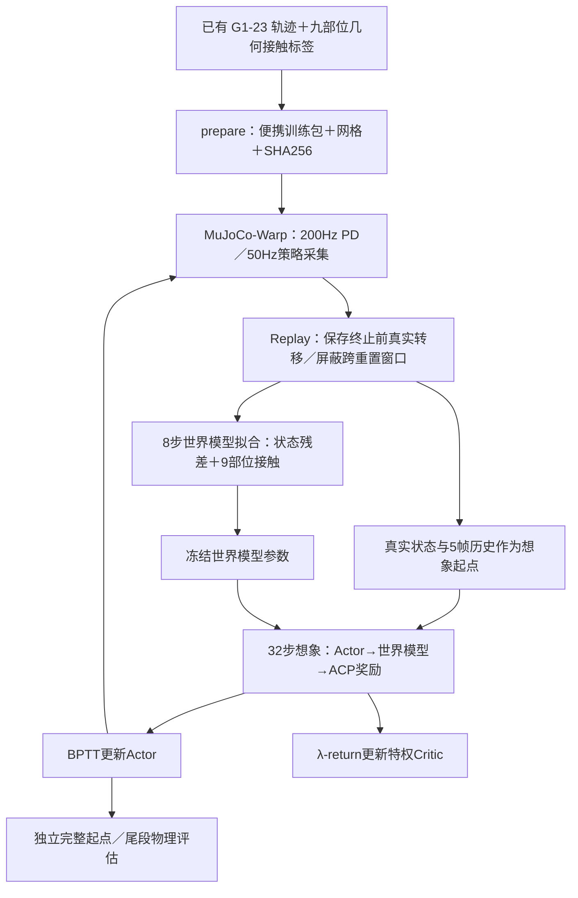

# SuperMimic 迁移与 4090 部署

2026-11-03 按用户要求改用世界模型训练方法，并新建 `feat/supermimic-stage1` 分支。`main` 保留原 PPO 实现。旧 A5000 机器上等待空闲 GPU 的诊断队列已停止，没有启动其中四组物理诊断，也没有补跑 PPO。

## 1. 实验定位与当前状态

本分支保留 ACP Stage 1 的接触条件策略、23DoF 球手、两片段选择、奖励权重和 CSI，参考本机 InstinctMJ 的 SuperMimic 实现，替换物理后端和优化方法。这是 ACP＋SuperMimic 实验版本，不能表述为论文 PPO 的完全同配置复现，也不能把此前 PhysX 的 M2 验收直接转移给 MuJoCo-Warp。

当前已通过本机及远端 CPU 冒烟：两种地形、468／353 维观测、参考关节只进入 critic、世界模型与 BPTT 有限梯度，optimizer steps=0。CPU 对照覆盖原 Stage1 观测逐元素一致、九关键点 FK、两种高程网格与 MuJoCo 射线、回放窗口跨重置掩码、随机化参数恢复。CUDA 步进、CUDA Graph／编译性能、完整规模显存与成功率尚待 GPU 空闲后验证，没有本项目新的正式训练结果或提速倍数。

## 2. 方法与边界



| 项目 | 本分支 |
| --- | --- |
| Actor | 468→512→256→128→23，ELU；5×75 本体历史＋63高程＋27接触目标＋3导航目标 |
| Critic | 353→512→256→128→1，ELU；保留原 ACP 特权信息 |
| 参考姿态 | 不进入 actor；用于训练奖励、critic、参考重置和几何 oracle 标签 |
| 世界模型 | 三层 2048、LayerNorm／SiLU；局部状态增量＋9部位接触 logits |
| 模型输入 | 去平移／yaw 的状态、动作、物理随机化 context、上一动作、187高程 |
| 模型训练 | 8步自回归拟合；终止转移保留，重置之后的窗口项屏蔽 |
| Actor 更新 | 32步可微想象，冻结世界模型／critic 参数，沿状态梯度更新 actor |
| Critic 更新 | 想象轨迹的 λ-return；γ=.99，λ=.95 |
| 调度 | UTD=.4；初始64控制步采集；前500次只拟合世界模型；无 PPO 更新 |
| 优化 | AdamW，初始学习率2e-4、余弦衰减，WM MLP 可用 bf16，状态／FK／奖励为 fp32 |
| 采样批量 | `wm_batch=2048`、`pi_batch=1024` 为两种场景合计，场景间均分 |
| 地形 | 按真实静态三角形做向下查询，保留原 ij 排序和高程正负号；不对箱沿平滑 |

世界模型不接收参考关节命令，动力学不依赖选中的参考动作。接触标签仍来自原几何标注；真实仿真的力标签作为世界模型接触头监督。该步骤没有把摔倒撞箱当作正确支撑标签重新写回原数据。

与参考 InstinctMJ 的区别：使用实际球手23DoF／pelvis 根系，支持固定腕和固定后代；采用 ACP 的高程图与接触条件 MLP，不使用其深度编码器、视觉 latent 或未来10帧参考关节输入；沿用 ACP 的 CSI，不使用原任务的 adaptive bins。本版本未接入可选 failure head 和 AMP／WASABI 风格判别器。

## 3. 物理引擎差异必须随结果报告

`configs/stage1.json` 提供 ACP 观测噪声、动力学随机化及14项奖励；`configs/m2.json` 提供关节顺序、PD、力矩上限、球手关键点。训练超参数单独放在 [supermimic.json](../../configs/supermimic.json)。

- 质量／惯量按相同比例缩放，torso COM、armature、PD、零位偏差、动作延迟均采样并作用于仿真；启动参数跨 reset 保留，检查点包含实际物理样本。
- MuJoCo 只有单一 Coulomb 系数。本实现使用动态摩擦样本，记录静摩擦样本；机器人 geom 的 priority=1，地形为0，避免默认 max 混合掩盖小于地面系数的样本。它不等价于 PhysX 的静／动摩擦组合。
- 恢复系数通过 `solref` 阻尼比近似，`ζ=-ln(e)/sqrt(π²+ln(e)²)`，并非 PhysX 的逐碰撞弹性模型。
- 真实接触使用世界法向力，按9部位固定后代求和，4个子步中 `max(abs(Fz))>1N`；想象奖励使用接触概率。水平箱壁接触的语义仍有旧审计指出的限制。
- 想象中的力矩正则用预测控制步终点的 PD 力矩近似末子步；真实奖励使用物理步实际力矩。高程不表达悬挑下表面；MuJoCo 没有直接配置同一 PhysX 关节速度硬限位，速度限制仍用于奖励。

配置的 `acknowledge_engine_mapping=true` 明确登记这组实验约定，并不意味着这些差异已经通过 CUDA／动力学对照验收。

## 4. 4090 机器与目录

```text
/home/hitcsc/lyx/
├── ACP_repro/                         # feat/supermimic-stage1
│   ├── .venv -> ../ACP_deps/venv
│   ├── outputs/数据集/supermimic/walk_box_v1/
│   └── outputs/实验归档/stage1/supermimic/
└── ACP_deps/
    ├── venv/                          # 独立 Python 3.12 环境
    ├── InstinctMJ/                    # 用户指定本机参考仓库的实际文件快照
    └── environment-freeze.txt         # 远端包版本证据
```

主机 `hitcsc@192.168.50.236`，RTX4090 24GB，驱动580.178.04。部署初查 GPU 已有其他任务，显存约21GB；不终止这些任务，不自动排队训练。本阶段仅执行 CPU 检查。密码不写入代码、文档或配置。

已复制该机器可工作的 Python 环境到独立 ACP 目录，避免慢速重下载 CUDA 依赖。只在 ACP 副本安装测试依赖；原项目的环境和源码不改写。核心版本为 PyTorch2.10.0＋cu128、MuJoCo3.11.0、MuJoCo-Warp3.11.0、Warp1.14.0。冷安装时在独立环境安装 [训练依赖](../../configs/supermimic-requirements.txt)，不要在这里安装数据标注用的 Drake 环境。

## 5. 数据包与传输

数据包约32MiB，只包含当前 walk／box 两个选定片段及所有运行依赖网格，PHP 不进入。原始 manifest 和全数据集不需要跟随训练机；原始标签／数据质量状态不改写，两个片段的 `experimental_data_override` 继续记录。两条轨迹的文件 SHA256 与原训练选用数据一致。

```text
walk_box_v1/
├── package.json      # 完整 ACP 配置、片段窗口、源哈希、每个文件哈希
├── meshes/           # 按内容哈希去重复；XML 使用相对路径
├── walk/{motion.npz,scene.xml}
└── box/{motion.npz,scene.xml}
```

在有完整数据资产的本机生成新批次，目标目录必须不存在：

```bash
/home/lyx/.holosoma_deps/miniconda3/envs/hsretargeting/bin/python \
  scripts/acp_pipeline.py supermimic prepare \
  --task walk_box --package outputs/数据集/supermimic/walk_box_v2
rsync -av --mkpath outputs/数据集/supermimic/walk_box_v2/ \
  hitcsc@192.168.50.236:/home/hitcsc/lyx/ACP_repro/outputs/数据集/supermimic/walk_box_v2/
```

当前 v1 已传输并在远端检查。数据变化必须生成新包，不能改写已有包后继续旧检查点。训练包不通过 Git 传输。

## 6. 统一操作命令

```bash
ssh hitcsc@192.168.50.236
cd /home/hitcsc/lyx/ACP_repro
git branch --show-current

# 不创建 CUDA 上下文：校验全部哈希、编译两个模型
.venv/bin/python scripts/acp_pipeline.py supermimic check

# CPU 小夹具：真实步进、观测隔离、世界模型／BPTT反传，优化器更新为0
.venv/bin/python scripts/acp_pipeline.py supermimic smoke --device cpu --num-envs 4

# 仅在 GPU 空闲后手动执行。不会自动结束其他任务。
.venv/bin/python scripts/acp_pipeline.py supermimic smoke --device cuda:0 --gpu 0 --num-envs 4
.venv/bin/python scripts/acp_pipeline.py supermimic benchmark \
  --device cuda:0 --gpu 0 --num-envs 1024 --steps 128
```

`smoke` 用小世界模型和短想象验证接口，不代表正式模型收敛。`benchmark` 先预热并同步 CUDA，只计“物理采集＋观测＋actor＋replay”吞吐，不包含 WM／BPTT 优化；不能将它的 FPS 当作完整训练提速。每次新建产物目录，保留实际配置、源文件哈希、包哈希、版本及结果。

下列是后续明确启动训练时的命令，本阶段**尚未执行**。先完成 CUDA 冒烟与规模检查，再确定正式环境数及预算：

```bash
.venv/bin/python scripts/acp_pipeline.py supermimic train \
  --device cuda:0 --gpu 0 --num-envs 1024 --iterations 10000 \
  --output outputs/实验归档/stage1/supermimic/walk_box_run1

# 恢复相同包／配置／环境数：会恢复WM、策略、优化器、CSI和实际随机化参数
.venv/bin/python scripts/acp_pipeline.py supermimic train \
  --device cuda:0 --gpu 0 --num-envs 1024 --iterations 1000 \
  --checkpoint outputs/实验归档/stage1/supermimic/walk_box_run1/latest.pt \
  --output outputs/实验归档/stage1/supermimic/walk_box_resume1

# 独立物理评估，分别从0和0.9相位开始；禁止用尾段成功率代替完整成功率
.venv/bin/python scripts/acp_pipeline.py supermimic evaluate \
  --device cuda:0 --gpu 0 --num-envs 1024 \
  --checkpoint outputs/实验归档/stage1/supermimic/walk_box_run1/latest.pt
```

恢复时 replay 重新采集，episode 状态和 RNG 不做逐位续接；不能声称严格确定性续训。原 PPO 检查点被明确拒绝，避免把不同训练状态混用。独立评估保留启动动力学，关闭观测噪声／重置扰动，保存每种任务的实际轨迹、参考、法向力、成功率及未完成数量；结果需要进一步人工视频复核。

## 7. 文件查询与阶段维护

入口仍只有 `scripts/acp_pipeline.py`。新算法模块在 `src/acp/training/supermimic/`，没有新增散落脚本；按职责拆分 assets、env、model、task、runner、rotations。来源见 [InstinctMJ 说明](../../third_party/instinctmj/README.md)，模块索引见 [仓库文件与架构查询](../03_方法与规范/仓库文件与架构查询.md)。

```bash
.venv/bin/python scripts/acp_pipeline.py structure --stage "本次阶段说明"
.venv/bin/python scripts/acp_pipeline.py check --manifests
```

全资产 `check --manifests` 在拥有原始资产的工作站执行；训练机仅部署便携训练包，使用 `supermimic check` 验证其完整性。
