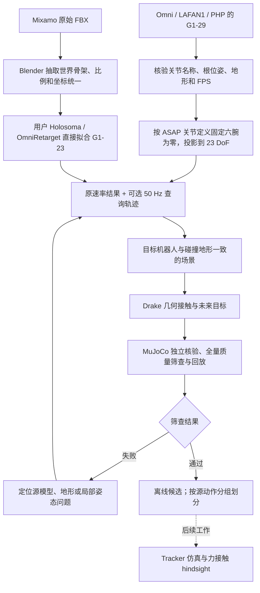

# G1-23 动作与接触数据流水线手册

本文是实验室复用的主说明，覆盖输入核验、关节转换／人体重定向、地形、接触标注、独立检查、回放与资产追溯。命令速查见 [快速开始](快速开始.md)，目录与版本规则见 [资产规范](../03_方法与规范/资产与版本管理规范.md)。

## 一、目标、边界和当前状态

目标输出是统一球手 G1-23 的运动学参考：机器人姿态、静态碰撞地形、九部位几何接触及未来接触目标。可以用于准备 Stage 1 参考数据和验证适配器。当前没有执行 Tracker/ACP 训练，也没有生成来自接触力的成功 rollout hindsight。

| 数据源 | 已核验规模 | 处理路线 | 当前资产定位 |
| --- | ---: | --- | --- |
| OmniRetarget robot-terrain | 145 条、29 个基础动作 × 5 个高度变体 | G1-29→23 名称投影 | 全量基线、肩肘局部修正试验 |
| LAFAN1 G1 重定向版 | 40 条、264,705 原始帧、30 Hz | G1-29→23 名称投影 | 全量基线；50 Hz 标签为 441,140 帧 |
| Mixamo | 2,453 个动画 FBX；已抽取 520,661 原始帧 | 人体骨架→OmniRetarget→G1-23 | 修复版持续批处理；坐下／爬梯回归单独保存 |
| PHP | 140 条、103,856 帧、50 Hz；每条 10 个地形变体 | G1-29→23 名称投影 | 140 条均已尝试；135 条处理完成，5 条几何查询异常；均待质量修正 |

规模是 2026-10-30 的来源清点。动态完成数量以统一入口 `status` 为准，最终质量以各批次报告为准。Omni/LAFAN 的严格全片筛查仍有修正项，不能从“已生成标签”推断全部可训练。

## 二、全流程与两种入口




### 已有 G1-29：保留动作，按名称缩减关节

Omni/LAFAN/PHP 的动作已经完成机器人重定向，无需先恢复人体关节。`src/acp/robot/joints.py` 按关节名称找出目标关节，保留源关节值；目标模型把左右腕 roll/pitch/yaw 共六轴固定在零位，三轴腰、双腿和肩肘保留。

这一步是固定腕关节的运动学投影。其子集定义参考 ASAP，**不是一个随训练进度变化的退火流程**，也不是重新运行 ASAP 的 SMPL 拟合。根轨迹、腿、腰和保留的肩肘数值应逐项一致。腕部下游的手端位姿可能发生变化，因此需要成对检查手接触；有问题时优先只修肩肘，保留原本正确的根、腰、腿。

统一目标由 `src/acp/robot/model.py` 从 Omni 球手模型生成，保留其几何与质量，在语义脚底增加固定 frame。ASAP 的参考模型及配置只用于确定关节定义，具体版本和哈希写入 `assets/provenance.json`。不能仅凭“23DoF”认定另一 URDF 与当前动作兼容。

### 原始 Mixamo：直接拟合 23DoF

1. `src/acp/pipeline/blender.py` 用 Blender 后台读取 FBX，提取 22 个世界坐标骨架点、采样率、帧数和来源哈希。
2. `src/acp/data/adapters/mixamo.py` 按骨架比例缩放，统一初始平面位置和朝向，保留有意义的绝对高度。坐下／爬梯不能把初始 root Z 当地面强行归零。
3. `src/acp/pipeline/datasets/mixamo.py` 驱动用户 Holosoma 分支。脚趾使用前脚端 frame，防滑约束只在相邻支撑帧启用；手部支撑需同时满足场景、运动和几何条件。
4. `src/acp/pipeline/contact_solver.py` 提供支撑代价与薄横杆穿透回溯；通用碰撞、关节与速度约束保持有效。数值重试必须检查残差，不能仅靠求解器“success”状态通过。
5. 场景、人体语义、支撑掩码、模型及代码版本都记录在结果中。主入口 `run_mixamo_configured.py` 只注入机器资源，保留既有生产器文件指纹，以兼容当前进行中的批处理。

具体修复证据见 [Mixamo 修复记录](../05_实验记录/Mixamo坐下与爬梯修复.md)。五类爬梯／坐下匹配来自候选参考动画的形状和时长比对，候选名不能当作原始身份已证明。

## 三、输入契约：先核验，再转换

所有长度为米，角度为弧度，时间为秒。根状态里的四元数次序与位置排列必须显式区分。

| 输入／中间文件 | 根布局 | 关节 | 场景 |
| --- | --- | --- | --- |
| Omni `robot-terrain/*.npz:qpos` | WXYZ, XYZ | 源 MJCF/URDF 对应顺序 | 源 `models/terrain`，随高度变体配对 |
| LAFAN `g1/*.csv` | XYZ, XYZW | 文档确定的 G1-29 名称顺序 | 明确采用 z=0 平地假设 |
| PHP `*_motion.npz:joint_pos` | XYZ, WXYZ | 同包 `joint_names`，不能盲目取前 23 项 | 同名前缀 `*_terrain.npy` |
| Holosoma `retargeted/*_original.npz:qpos` | XYZ, WXYZ | 目标 MJCF 顺序 | manifest 指定场景 |
| `source29.npz` / `source_rate_subset.npz:qpos` | WXYZ, XYZ | 文件内 `joint_names` | 对应 clip 的 terrain |
| `labeled/motion.npz` | 分字段 position 与 quaternion_wxyz | 文件内 `joint_names` | 来源／哈希在 report 中 |

PHP 地形形状为 `[箱子数, 变体数, 10]`，每个箱子是 `XYZ + WXYZ + full_size_XYZ`。URDF box 直接使用完整边长；MuJoCo box 的半尺寸由场景生成器转换。空箱体数组表示只有平地。不能把变体轴当作箱体轴，也不能把完整边长再次乘二。

PHP 输入格式使用其实际 `mjcf/g1.xml` 对照包内 `body_pos_w` 做独立 FK 检查；再用统一球手 G1-29 作 29→23 对比。这两个模型承担不同验证职责。PHP 模型和统一模型的几何／限位差异需单独复核，转换不会默默改高 root 或改写源地形。

## 四、采样率和时间边界

论文控制频率为 50 Hz，PD 为 200 Hz；原始动作文件并不要求必须存成 50 Hz。当前管线保存原速率的精确子集，并默认生成 50 Hz 参考查询版本：

- Omni、LAFAN 源 30 Hz：先保留原始结果，再插值到目标时间网格。
- PHP 源 50 Hz：相同速率不需要额外插值。
- Mixamo 按每文件真实 FPS 读取，输出时间轴由 `--fps` 指定。

位置和关节角线性插值，根旋转用 SLERP；目标最后时间不超过源片段终点。`source_rate_subset.npz` 是核验“是否保留原动作”的依据，不能拿不同时间网格逐帧相减。

1.5 秒未来窗口和 0.2 秒接触段按实际输出速率换算：50 Hz 对应 75／10 步，30 Hz 对应 45／6 步。`--fps 30` 可以用于诊断，正式对齐论文控制器时优先取 50。

## 五、接触标签如何生成

标注进程由统一入口加资源超时，超时记录处理失败，不把无结果当作无接触。

主要实现为 `src/acp/data/scene.py`、`holosoma.py`、`contacts.py`，由 Drake 逐帧 FK 和有符号几何距离计算，不进行动力学积分。

九部位固定顺序：左脚、右脚、左膝、右膝、左手、右手、左肘、右肘、骨盆。接触位置使用碰撞查询的地形表面 witness，身体语义参考点另存 `body_landmarks_w`，二者不可混用。

当前离线工程设置：距离不大于 15 mm，允许穿透不大于 3 mm；几何或关节限位无效帧不产生有效 raw 接触；删除短于 0.2 秒的接触段。向后寻找未来 1.5 秒内下一次有效接触 onset，将表面点变换到当前 root 的 yaw 坐标系，仅去 yaw，保持重力轴。footprint 使用 x∈[-0.8,0.8]、y∈[-0.5,0.5] m；没有落入窗口的目标则 occupancy=false。

onset 边界以 `contacts.next_onset_targets` 为准。当前 onset 本身属于可查询未来范围；尾部不足完整窗口的位置另有掩码，不能直接当作无接触负样本。参数、frame 映射和局部偏移均写入 `labeled/report.json`。

几何标签与论文后续 rollout 中按接触力阈值产生的标签是两个阶段。离线距离标签不能替代真实支撑力、稳定性或控制可跟踪性的证据。

### 实际 `labeled/motion.npz` 字段

| 字段 | 形状／作用 |
| --- | --- |
| `timestamps`, `fps` | T 个严格递增采样时间、标量频率 |
| `base_position_w`, `base_quaternion_wxyz` | [T,3]、[T,4]，世界位置与根旋转 |
| `base_linear_velocity_w`, `base_angular_velocity_w` | [T,3]，世界坐标速度 |
| `joint_positions`, `joint_velocities`, `joint_names` | [T,23]、[T,23]、23 个名称 |
| `body_names`, `body_landmarks_w` | 九部位顺序、[T,9,3] 身体参考点 |
| `geometric_signed_distances`, `contact_surface_positions_w` | [T,9]、[T,9,3]，距离与最近地形点 |
| `contact_flags`, `target_occupancy` | [T,9]，过滤后的接触、未来目标占据 |
| `target_positions_body_yaw` | [T,9,3]，当前 yaw 坐标下的未来目标 |
| `geometry_valid`, `joint_limits_valid`, `kinematic_constraints_valid` | [T]，当前帧有效性 |
| `velocity_limits_valid` | [T]，差分速度限位检查 |
| `future_complete`, `geometry_window_valid` | [T]，未来窗口完整性／几何与限位有效性 |

完整键名由实际 NPZ 和源代码定义；新增加载器应读取字段与名称，不能仅依赖列数。`geometry_window_valid` 不包含独立的速度与自碰撞筛查，训练读取时仍需结合批次质量和用途选掩码。

## 六、产物布局与来源追溯

```text
outputs/数据集/<dataset>/<run>/
├── assets/                     # 目标机器人、参考机器人、公共场景与 provenance
├── inventory.json              # 所有待处理输入，包含 source / route / motion_group
├── launches/                   # 统一入口记录的命令、本机配置、时间与 PID
├── conversion_results.json     # 本次处理结果；恢复后的 resumed 仍表示复用
├── quality_summary.json        # 最近一次全量质量快照
├── quality_all_clips.csv        # 全输入总表
├── artifact_index.json         # 回放与下游定位索引
└── clips/<clip_id>/
    ├── manifest.json           # 状态、来源、模型、命令／参数／指纹
    ├── source29.npz            # 部分适配器生成的统一源机器人状态
    ├── source_rate_subset.npz  # 原采样率、保留关节精确子集
    ├── terrain.urdf, scene.xml # 逐动作场景；公共地形路线可位于 assets 或源数据
    ├── retargeted/             # Holosoma 兼容 qpos、参考关键点与支撑标志
    ├── labeled/               # motion.npz + report.json
    ├── validation/            # MuJoCo 独立几何检查数组与报告
    ├── comparison/            # 已有机器人轨迹的 29／23DoF 成对检查
    ├── quality/               # 单条筛查结论与原因
    └── *.log                  # 逐阶段诊断
```

不同路线可能共用场景，或源 qpos 直接指向外部 Omni 文件；不要据示例树强行要求每条都有完全相同的文件。定位以 manifest 和 artifact index 为准。

文件内容的 SHA-256、目标模型、输入与代码指纹可识别“同名不同内容”。目录整理不会批量重写历史 manifest 或 NPZ；`acp.data.assets.read_record()` 在读取时将旧前缀映射到新目录，原证据保持可追溯。它不对任意文本做替换，也不把哈希当路径处理。

## 七、质量门槛、失败归因与修复顺序

筛查标准在 `configs/data_quality.json`，属于本项目工程门槛，不能标成论文官方准入标准。全片筛查同时检查地形穿透、关节角／速度、自碰撞、支撑近表面比例、脚滑动、参考关键点偏差和 Drake/MuJoCo 接触一致性。

| 状态 | 含义 | 下一步 |
| --- | --- | --- |
| `not_processed` / `running` | 尚无完整结果 | 查看进度与日志，保持全输入分母 |
| `excluded_input` | 原始输入过短等，已显式排除 | 保留原因和计数 |
| `processing_failed` / `evaluation_failed` | 代码、求解、依赖或文件故障 | 先修工程问题再评估 |
| `needs_repair` | 已完成处理，但至少一项筛查失败 | 依据失败帧与成对报告定位 |
| `offline_kinematic_candidate` | 通过当前离线标准 | 可进入 Stage 1 候选审核与控制训练 |

推荐处理顺序：

1. 检查 root、四元数、关节名称顺序、米／厘米、FPS、地形变体和模型版本。格式错误不能靠优化器补救。
2. 已有 G1-29 路线看 `comparison/report.json`：保留链 FK 应接近数值精度；分别统计源已有和投影后新增问题。不能把所有穿透归罪于 29→23。
3. 手接触丢失优先局部肩肘修正，查看 [局部修正规范](../03_方法与规范/肩肘接触局部修正.md)；新试验使用归档目录，修正完成重新标注与评估。
4. Mixamo 坐下需检查终段骨盆支撑、根高度和椅面；爬梯需检查双手支撑保持、薄横杆穿透以及脚端映射。没有原始物体时场景只能标为假设。
5. 原始自碰撞和校准后的意外自碰撞分开报告。Mixamo 使用的膝踝局部豁免绑定目标 URDF 哈希与空间、深度边界，不能把所有相邻身体碰撞统一忽略；PHP 当前报告仍沿用通用严格原始检查。
6. 同步看源和目标动画、最差帧以及接触标记。不能只选一个外观正常的帧判整条通过。

通过后也保留 source-motion 分组和失败来源。未来裁剪无效区间需要新批次／新片段 ID，重新计算窗口完整性；不能直接从结果表中删掉失败帧后拼接时间轴。

## 八、现有实现位置

| 任务 | 实现 |
| --- | --- |
| 实验室入口、状态、资源检查、资产目录 | `scripts/acp_pipeline.py` |
| 稳定资产 ID、历史路径解析 | `src/acp/data/assets.py` |
| 模型与关节缩减 | `src/acp/robot/model.py`, `src/acp/robot/joints.py` |
| Omni / LAFAN / PHP 批处理 | `src/acp/pipeline/datasets/omni.py`, `batch_lafan_asap23.py`, `batch_php_asap23.py` |
| PHP 包格式与箱体变体 | `src/acp/data/adapters/php.py` |
| Mixamo 抽取与重定向 | `src/acp/pipeline/blender.py`, `batch_mixamo.py`, `mixamo_contact_retargeter.py` |
| 时间与位姿规范化 | `src/acp/data/motions.py`, `holosoma.py` |
| 静态几何与未来接触 | `src/acp/data/scene.py`, `contacts.py` |
| 独立验证、成对检查和总评估 | `src/acp/quality/native.py`, `compare_asap23.py`, `evaluate_omni_terrain.py` |
| 交互与离线回放 | `scripts/view_omni_trajectory.py`, `src/acp/data/playback.py` |

扩展新来源时先实现严格输入适配器，保持输出命名、时间轴、目标模型和质量报告契约。不要为新数据集复制一套无法共同检查的标签逻辑。
