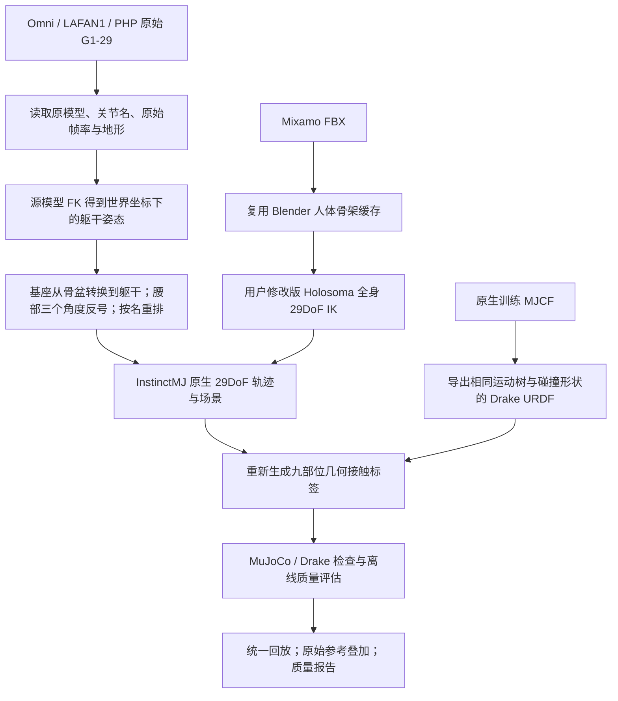

# G1 29DoF 数据版本：InstinctMJ 模型

23DoF 球手数据与本版独立保存。29DoF 统一使用 InstinctMJ 的
`assets/resources/unitree_g1/xml/g1_29dof_torsobase_popsicle.xml`，保留原生胶囊碰撞体、惯量和 29 个活动关节。
本机资源目录在 `configs/machine.local.json` 的 `instinct_g1_resource` 中配置；也可以用 `--robot-resource` 显式指定。

## 数据位置与来源

| 数据 | 稳定 ID | 目录 | 输入范围／方法 |
| --- | --- | --- | --- |
| OmniRetarget | `omni_instinct29` | `outputs/数据集/omni/instinct29_v1` | 145 条 robot-terrain 原始 G1-29 轨迹 |
| LAFAN1 | `lafan1_instinct29` | `outputs/数据集/lafan1/instinct29_v1` | 40 条开源 G1-29 CSV，原始 30Hz |
| PHP | `php_instinct29` | `outputs/数据集/php/instinct29_v1` | 140 条训练包，默认每条地形变体 0；保留箱体原尺寸、姿态与重叠 |
| Mixamo | `mixamo_instinct29` | `outputs/数据集/mixamo/instinct29_v1` | 2453 条 FBX 清单，复用人体骨架缓存，重新进行完整 29DoF Holosoma IK |

Mixamo 原始文件是 FBX，没有现成的 G1-29 关节轨迹。本版重新优化全部 29 个关节和基座；六个手腕自由度参加优化。
只有点位约束的动作，其手腕姿态仍存在欠约束，不能解读为原始人体手腕旋转真值。
极短静态片段会记录为 `excluded_too_short`，不生成伪造的多帧轨迹。每批实际数量和失败原因以 `conversion_results.json`、`quality_summary.json` 为准。

## 处理流程



### 基座和关节不能直接复制

原始机器人轨迹的自由基座通常是 `pelvis`，InstinctMJ 的基座是 `torso_link`。
这三个腰关节的父子运动链方向相反，因此要把 `waist_pitch/roll/yaw_joint` 角度取反，并以源模型 FK 计算的世界躯干姿态作为新的自由基座。
关节列按目标 MJCF 的名称顺序重新排列，手腕值原样保留。

模型版本仍有约厘米量级的位置差异，每条轨迹的 `model_conversion_report.json` 记录骨盆、躯干、脚踝、肘和手腕的位置误差。
本转换不执行全身 IK 修复或统一抬高机器人。保留下来的关节角度能够追溯至真实原始 29DoF 输入；23DoF 版本的肩肘修复不会自动继承。

同目录手写 URDF 与实际训练 MJCF 的碰撞形状有差异。本版由 MJCF 编译模型导出 Drake 使用的 URDF：球、胶囊、圆柱、盒体均保留其原形状与变换。
手写 URDF 仅提供各关节的速度、力矩上限。单元测试独立比较两引擎的全部身体位置，以及相同姿态下的地面距离。

### 接触标签

接触标签使用本版 29DoF 实际几何重新计算，包含左右脚、膝、手、肘和骨盆九组。默认输出 50Hz，判定距离 15mm、穿透容差 3mm，最短接触段 0.2s，未来窗口 1.5s。
Mixamo 的低速站立约束另用人体脚尖速度、地面／显式支撑面和 0.08s 稳定段计算；它与最终接触标签属于两个不同环节。
坐下、爬梯采用已有的显式支撑场景假设，其 `unconfirmed_support_scene` 状态会继续保留，实际原场景仍需要确认。

这些是几何接触与未来目标。Stage 2 的 hindsight 接触还需要成功 mimic 跟踪后的物理接触力回放。
`end_to_end_data_pipeline_completed_not_training_admitted` 表示处理链完成；`needs_repair` 表示触发离线检查项。应查看具体原因、比例和回放，不能把后者概括为原始动作错误。

## 生成、续跑与查看

在项目根目录运行。32GB 内存建议每次跑一个批次，从 4 workers 开始；多个批次并行时要控制进程总数。
Mixamo 的完整全身优化比已有机器人轨迹的坐标转换耗时更长，后台进程与日志记录在各批次目录。

```bash
.venv/bin/python scripts/acp_pipeline.py run omni --dof 29 --workers 4 --label-timeout 600 --background
.venv/bin/python scripts/acp_pipeline.py run lafan1 --dof 29 --workers 4 --label-timeout 600 --background
.venv/bin/python scripts/acp_pipeline.py run php --dof 29 --workers 4 --label-timeout 600 --background
.venv/bin/python scripts/acp_pipeline.py run mixamo --dof 29 --workers 4 --label-timeout 600 --background
```

上面四行是独立命令示例，按需逐批启动。相同命令会复用输入、模型和代码指纹一致且关键文件齐全的完成结果。
正在运行的批次会拒绝重复启动。改变模型或参数时应使用新的 `--output`；入口也会拒绝把两种 DoF 写进同一目录。
不传 `--dof` 时，仍处理原来的 23DoF 默认批次。

```bash
# 先处理单条，使用单独目录
.venv/bin/python scripts/acp_pipeline.py run omni --dof 29 \
  --clips climb_00_z_scale_0.9 --output outputs/实验归档/native29/omni_smoke --workers 1

# PHP 可显式处理全部提供的地形变体；建议放入新的输出目录
.venv/bin/python scripts/acp_pipeline.py run php --dof 29 --all-variants \
  --output outputs/实验归档/native29/php_all_variants --workers 4 --background

.venv/bin/python scripts/acp_pipeline.py status omni_instinct29
.venv/bin/python scripts/acp_pipeline.py status mixamo_instinct29
.venv/bin/python scripts/acp_pipeline.py view omni_instinct29 --clip climb_00_z_scale_0.9 --show-source
.venv/bin/python scripts/acp_pipeline.py view mixamo_instinct29 --clip 0f3625529b2f2b0f970819e47fb7de1a --show-source
.venv/bin/python scripts/acp_pipeline.py evaluate omni_instinct29 --workers 4
.venv/bin/python scripts/acp_pipeline.py check --manifests --playback
```

回放与视频导出共用原入口；指定 29DoF 的稳定 ID 即会加载对应模型。
Omni／LAFAN1／PHP 的源叠加使用按本批时间戳保存的原始 29DoF 模型 FK，避免不同模型的固定链接名称混用。Mixamo 叠加原始人体骨架。

## 文件与坐标约定

```text
instinct29_v1/
  dataset_version.json          # dataset / dof=29 / root_body=torso_link
  assets/
    g1_29dof_torsobase_popsicle.xml    # 实际训练模型，Mixamo 批次含默认地面
    g1_29dof_torsobase_popsicle.urdf   # 由原生 MJCF 导出的标注几何
    provenance.json                  # 模型来源、关节名、哈希与导出说明
    source_robot.xml                 # 三类原生29数据对应的原模型
    source_provenance.json
  inventory.json
  conversion_results.json
  artifact_index.json
  quality_summary.json
  clips/<clip>/
    manifest.json
    source29.npz                # 原始帧率、原始模型关节顺序与根坐标；三类现成29数据
    source_rate_motion.npz      # 原始帧率上的 InstinctMJ 躯干基座版本
    model_conversion_report.json
    terrain.urdf / scene.xml
    retargeted/<clip>_original.npz
    labeled/motion.npz
    labeled/report.json
    validation/mujoco_geometry.npz
    quality/report.json
```

Mixamo 保存 `human_reference.npz`、`retarget.log`，有支撑场景时使用 `support.urdf`、`support_scene.xml`；不生成不存在的原始机器人 `source29.npz`。

| 文件 | 根与关节布局 |
| --- | --- |
| `source29.npz` | `qpos=[WXYZ,XYZ,29关节]`，根是输入原模型的基座；查 `joint_names` |
| `source_rate_motion.npz` | `qpos=[WXYZ,XYZ,29关节]`，根是躯干；查 `joint_names` |
| `retargeted/*_original.npz` | MuJoCo `qpos=[XYZ,WXYZ,29关节]`，根是躯干 |
| `labeled/motion.npz` | 分开的 `base_position_w`、`base_quaternion_wxyz`、`joint_positions[T,29]`；`base_body_name=torso_link` |

```python
import numpy as np
with np.load('outputs/数据集/omni/instinct29_v1/clips/climb_00_z_scale_0.9/labeled/motion.npz') as z:
    print(str(z['base_body_name']), z['joint_positions'].shape)
    print(z['joint_names'].tolist())
    qpos_mujoco = np.c_[z['base_position_w'], z['base_quaternion_wxyz'], z['joint_positions']]
```

当前 Stage 1 / SuperMimic 的策略维度和机器人控制仍按原 23DoF 配置。29DoF 数据版作为独立资产提供，训练接入需要同步修改动作维度、观测维度、模型和基座语义。
