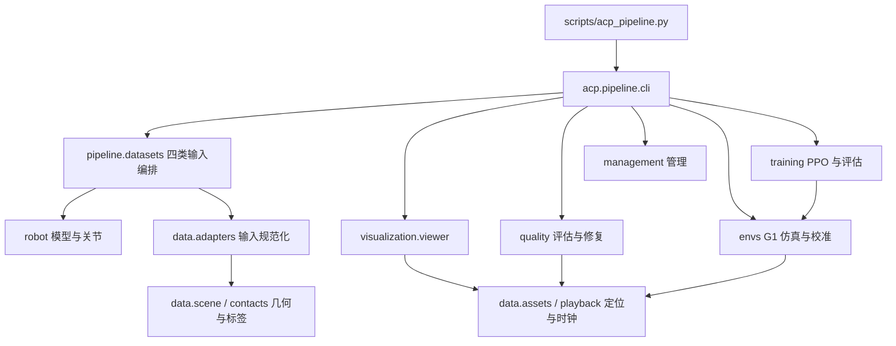

# 仓库文件与架构查询

日常只用 `scripts/acp_pipeline.py`。`scripts/view_omni_trajectory.py` 是旧回放命令兼容入口，默认 Omni，指定 `--run` 可播放其他已生成数据。算法实现位于 src，禁止用 scripts 目录作为 Python 导入库。

## 按功能查命令

| 需求 | 统一命令 |
| --- | --- |
| 环境与数据入口 | `doctor`、`list` |
| 四类数据批处理 | `run omni/lafan1/mixamo/php` |
| 实时状态／资产目录 | `status <数据集或批次>`、`catalog` |
| 回放／视频／定格图 | `view <数据集或批次> --clip <ID> [--show-source] [--output ...]` |
| 全量质量检查 | `evaluate <数据集或批次>` |
| 机器人 29/23 对比 | `compare --run <批次> ...`，Mixamo 原始人体不走此对比 |
| 肩肘局部修正／重新标注 | `repair --baseline ... --output ... --clips ...`、`finalize --run ...` |
| Mixamo 场景／语义候选 | `fit-scenes ...`、`match-names ...` |
| 文档和资产完整性 | `check --manifests` |
| 架构索引与阶段记录 | `structure --stage "本次完成的阶段"` |
| 跨机器模型路径副本 | `materialize`，读取本机路径映射 |
| IsaacLab 单卡环境预检 | `sim-check --gpu <空闲物理编号或UUID> --steps 1000` |
| M2 机器人与仿真验收 | `calibrate --gpu 0 --num-envs 1 16 64 --policy-steps 500 --render` |
| Stage 1 共享 Tracker 训练 | `train --task walk_box --gpu 0 --num-envs 2048 --iterations 10000 --background` |
| 历史目录迁移 | `migrate`，只用于目录管理 |

上述均接在 `.venv/bin/python scripts/acp_pipeline.py` 后；专项功能使用 `<命令> --help` 查看具体参数。不同原始格式保留适配器，回放、标签和总评估共用实现。

## 调用关系

## 目录与职责

- `src/acp/pipeline/`：统一编排：命令、资源限制、Blender 与支撑场景工具。
- `src/acp/pipeline/datasets/`：数据集适配编排：共享输出契约，输入差异独立保留。
- `src/acp/robot/`：机器人：模型、关节子集、碰撞策略和源 FK。
- `src/acp/envs/`：仿真：G1 批量 PD、真实地形、M2 验收和 Stage 1 任务。
- `src/acp/training/`：Stage 1：GPU 参考与接触查询、原生 PyTorch PPO、共享策略训练与评估。
- `src/acp/quality/`：质量：独立检查、全量筛查、29/23 成对诊断及局部修复。
- `src/acp/visualization/`：可视化：所有数据集共用的回放、源轨迹叠加和导出。
- `src/acp/data/`：共享数据契约：时间、几何、接触、资产定位与播放时钟。
- `src/acp/data/adapters/`：输入适配：人体骨架、Holosoma 输出和 PHP 包格式。
- `src/acp/management/`：管理：完整性检查、状态、迁移、架构索引和重构追溯。

`configs/` 管理资源、准入门槛、场景假设、批次和路径映射；`tests/` 验证契约与数值行为；`docs/` 保存知识库；`outputs/` 按用途管理产物。源码重构前备份、删除清单与哈希兼容证明在 outputs/管理 和 configs/code_relocations.json。

## 模块清单（自动扫描）

以下清单由 `structure` 生成，包初始化文件省略。实现文件保留直接运行能力以支持独立环境的子进程；用户操作优先通过统一入口。

| 文件 | 用途 |
| --- | --- |
| [src/acp/data/adapters/holosoma.py](../../src/acp/data/adapters/holosoma.py) | Holosoma 输出规范化与九部位几何接触标注 |
| [src/acp/data/adapters/mixamo.py](../../src/acp/data/adapters/mixamo.py) | 所在 datasets 时负责 FBX→G1-23 批处理；所在 adapters 时负责骨架预处理 |
| [src/acp/data/adapters/php.py](../../src/acp/data/adapters/php.py) | 所在 datasets 时负责批处理；所在 adapters 时负责命名关节和箱体读取 |
| [src/acp/data/assets.py](../../src/acp/data/assets.py) | 稳定 ID、机器配置、历史路径解析和原子 JSON |
| [src/acp/data/contacts.py](../../src/acp/data/contacts.py) | 接触段过滤、未来 onset 目标和尾部掩码 |
| [src/acp/data/motions.py](../../src/acp/data/motions.py) | 源格式读取、时间网格和旋转插值 |
| [src/acp/data/playback.py](../../src/acp/data/playback.py) | 播放索引定位与独立播放时钟 |
| [src/acp/data/scene.py](../../src/acp/data/scene.py) | Drake FK、碰撞距离和接触表面 witness |
| [src/acp/envs/calibrate.py](../../src/acp/envs/calibrate.py) | 统一 M2 验收：站立、参考重置、限幅、地形配准、接触夹具与批量报告 |
| [src/acp/envs/conversion.py](../../src/acp/envs/conversion.py) | 保留惯量的 URDF 清理、九部位分组和真实场景三角网格转换 |
| [src/acp/envs/g1.py](../../src/acp/envs/g1.py) | IsaacLab G1-23：200Hz PD、参考 reset、九部位接触与高度扫描 |
| [src/acp/envs/randomization.py](../../src/acp/envs/randomization.py) | Table S2：固定启动动力学及 PhysX 回读、动作延迟、里程计和观测／重置扰动 |
| [src/acp/envs/reference.py](../../src/acp/envs/reference.py) | 仿真无关的按名称动作加载、SLERP 查询与动作／关节目标转换 |
| [src/acp/envs/stage1.py](../../src/acp/envs/stage1.py) | Stage 1 物理任务：按场景分配环境、468/353 观测、论文奖励及 CSI |
| [src/acp/management/check.py](../../src/acp/management/check.py) | 只读检查文档链接、目录和已完成片段关键路径 |
| [src/acp/management/fingerprints.py](../../src/acp/management/fingerprints.py) | 核对精确重构文件后兼容旧代码身份；后续编辑使兼容失效 |
| [src/acp/management/organize.py](../../src/acp/management/organize.py) | 已有资产目录迁移工具；非日常数据处理步骤 |
| [src/acp/management/portable.py](../../src/acp/management/portable.py) | 生成跨机器模型路径副本和前后哈希，保留原始模型证据 |
| [src/acp/management/simulation.py](../../src/acp/management/simulation.py) | 按物理 GPU／UUID 隔离 IsaacLab 空场景预检，记录步进与退出码 |
| [src/acp/management/status.py](../../src/acp/management/status.py) | Mixamo 增量进度统计，供批处理和统一入口使用 |
| [src/acp/management/structure.py](../../src/acp/management/structure.py) | 扫描实际模块生成本索引，并写阶段完成记录 |
| [src/acp/pipeline/blender.py](../../src/acp/pipeline/blender.py) | Blender 进程内的 FBX 世界骨架抽取 |
| [src/acp/pipeline/cli.py](../../src/acp/pipeline/cli.py) | 统一命令解析、环境选择、批次启动、状态与资产目录 |
| [src/acp/pipeline/contact_solver.py](../../src/acp/pipeline/contact_solver.py) | Mixamo 支撑代价、真实几何回溯与接触约束扩展 |
| [src/acp/pipeline/datasets/lafan1.py](../../src/acp/pipeline/datasets/lafan1.py) | LAFAN1 G1 CSV→23DoF 批处理及模型版本对比 |
| [src/acp/pipeline/datasets/mixamo.py](../../src/acp/pipeline/datasets/mixamo.py) | 所在 datasets 时负责 FBX→G1-23 批处理；所在 adapters 时负责骨架预处理 |
| [src/acp/pipeline/datasets/omni.py](../../src/acp/pipeline/datasets/omni.py) | Omni robot-terrain 的 G1-29→23 批处理 |
| [src/acp/pipeline/datasets/php.py](../../src/acp/pipeline/datasets/php.py) | 所在 datasets 时负责批处理；所在 adapters 时负责命名关节和箱体读取 |
| [src/acp/pipeline/mixamo_resources.py](../../src/acp/pipeline/mixamo_resources.py) | 注入机器资源并调用 Mixamo 批处理 |
| [src/acp/pipeline/names.py](../../src/acp/pipeline/names.py) | 按轨迹形状和时长匹配候选动作名称 |
| [src/acp/pipeline/scene_fit.py](../../src/acp/pipeline/scene_fit.py) | 拟合 Mixamo 候选椅子／梯子场景，仍需人工确认 |
| [src/acp/quality/compare.py](../../src/acp/quality/compare.py) | 29/23 同时钟的精确投影和新增／继承问题对比 |
| [src/acp/quality/evaluate.py](../../src/acp/quality/evaluate.py) | 四类数据共用的全量质量筛查、候选清单与报告 |
| [src/acp/quality/finalize.py](../../src/acp/quality/finalize.py) | 局部修复后重新标注、核验与总评估 |
| [src/acp/quality/native.py](../../src/acp/quality/native.py) | MuJoCo 独立几何核验 |
| [src/acp/quality/repair.py](../../src/acp/quality/repair.py) | 固定根、腰、腿的肩肘局部接触修复 |
| [src/acp/robot/collision.py](../../src/acp/robot/collision.py) | 限定模型哈希、身体范围与深度的局部碰撞校准 |
| [src/acp/robot/joints.py](../../src/acp/robot/joints.py) | ASAP 六腕固定定义和按名称关节投影 |
| [src/acp/robot/model.py](../../src/acp/robot/model.py) | 统一球手 G1-23 模型生成、MuJoCo 编译、场景生成 |
| [src/acp/robot/transfer.py](../../src/acp/robot/transfer.py) | 源机器人模型加载与 FK 关键点；所有机器人适配器及回放共用 |
| [src/acp/training/ppo.py](../../src/acp/training/ppo.py) | 非对称 actor/critic、运行归一化、显式超时 bootstrap 的 GAE 与 PPO |
| [src/acp/training/runner.py](../../src/acp/training/runner.py) | Stage 1 单卡启动、训练／评估、TensorBoard、checkpoint 与断点续训 |
| [src/acp/training/task.py](../../src/acp/training/task.py) | GPU 参考库、实际 yaw 下的 oracle 接触、CSI 更新及 Table 3 奖励公式 |
| [src/acp/visualization/viewer.py](../../src/acp/visualization/viewer.py) | 共用交互回放、PNG/MP4、源轨迹叠加与最差帧定位 |

## 维护规则

每完成一个涉及代码、目录、入口或接口变化的阶段，运行 `structure --stage "阶段说明"`，再运行 `check --manifests`。增加或删除模块时同步维护本生成器中的用途描述、统一入口、测试和快速开始。阶段历史见 [阶段完成记录](../05_实验记录/阶段完成记录.md)。

已退役的旧脚本不再作为操作入口；旧实验记录中的命令仅用于解释当时实验。历史代码可以从重构前备份恢复用于取证，禁止直接覆盖当前代码。具体迁移／删除明细见 [代码结构迁移记录](../../outputs/管理/代码结构迁移记录.json)。
