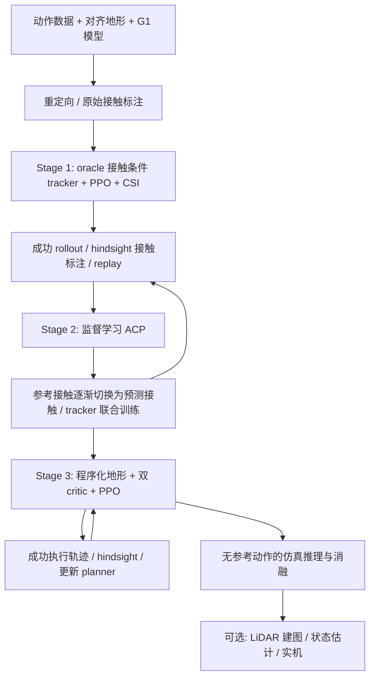

# Humanoid Mobility via Attention-based Contacts：复现路线

记录日期：2026-10-29。依据本地 arXiv **2610.31608v1，25 页**；下文页码均为 PDF 页码。

标记约定：**论文设定**表示原文披露；**工程建议**表示本项目拟采取的实现/验收选择；**待确认**表示不能据现有材料认定。

## 1. 目标与边界

默认首轮目标是 **Isaac Lab 仿真三阶段闭环**。LiDAR 建图、状态估计、Jetson 和 G1 实机单独作为后续阶段。先完成方法复现，再争取论文数值复现；两者不可混同。

方法的核心接口是接触：规划器根据本体状态、地形及目标，输出九个身体部位在未来 1.5 秒内的下一接触位置，控制器执行接触计划。没有有效接触的部位向控制器传入零向量。部署时不输入参考动作，也不需要动作生成器或显式技能切换。

**关键澄清**：无参考动作的推理接口，并不表示训练不使用参考运动学。Stage 1/2 仍使用基座、关节及接触的参考跟踪奖励；Stage 3 的参考环境也保留运动学监督。

算法训练顺序是 tracker → planner → 联合微调。实现顺序可以先完成可离线验证的标签器和网络，但离线合成数据实验不能代替成功物理 rollout。

## 2. 现状与资源

**后续更新**：用户已说明训练在其他机器进行，有 4090/5080/A5000 资源，并提供本地 G1、OmniRetarget 数据及在线 LAFAN/Mixamo 来源。已启动离线数据模块，最新状态见 [数据处理实施记录](../05_实验记录/早期方案/初版数据处理与模型核查.md)。下述“只有论文”和本机配置是首次梳理时的历史记录，不再表示全部可用资源。

工作目录目前只有论文素材，没有训练代码或机器人/动作/地形资产，也未初始化 Git。

本机探测：Ubuntu 22.04.5，RTX 4060 Laptop 8188 MiB，约 31 GiB RAM，当前文件系统约 134 GiB 可用，驱动 595.99.02。系统 `python3` 未发现 torch；有 `uv`。这不代表其他虚拟环境没有安装仿真器或 PyTorch。

论文 Training（p.16）报告：

| 阶段 | 论文耗时 | GPU | 每 worker 并行环境，Table S6 |
| --- | --- | --- | --- |
| Stage 1 | 约 1 天 | 3 × RTX 4090 | 12,000；表中未给分布式总量 |
| Stage 2 | 约 1 天 21 小时 | 2 × RTX 4090 | 2,400，总计 4,800 |
| Stage 3 | 约 2 天 6 小时 | 4 × RTX 4090 | 2,100，总计 8,400 |

不能据此线性推算本机耗时。8GB 显存首先面临仿真运行及缓冲区容量限制。

**工程建议**：本机承担数据处理、网络/损失验证及可运行时的小规模仿真；完整训练优先使用远程工作站。并行环境先从 1、16、64 逐级探测，记录显存和 steps/s，再决定训练规模，不预先承诺 8GB 能跑完整 Isaac Sim 工作流。

论文只披露 Isaac Lab，未披露版本。当前版本与历史版本的默认物理后端、Python 和 Isaac Sim 兼容关系已有变化，因此应先选定并锁定 **Isaac Lab + Isaac Sim/PhysX + PyTorch + Python** 的兼容组合，再装依赖。不能把切换 Newton 或 MuJoCo 当成对论文设置的等价替代。

官方安装参考：[Isaac Lab v2.3.1](https://isaac-sim.github.io/IsaacLab/v2.3.1/source/setup/installation/index.html)、[v3.0.0](https://isaac-sim.github.io/IsaacLab/v3.0.0/source/isaaclab/installation.html)。前者列出 16GB GPU 显存要求；后者支持独立 Newton 路径，但物理后端变更需单独记录。

## 3. 资产与公开资源核查

已查看[作者项目页](https://leggedrobotics.github.io/ACP/)、[方法页](https://leggedrobotics.github.io/ACP/method.html)和本地论文，并检索论文标题/编号对应代码。**截至本次核查，未在这些入口找到作者提供的训练代码、checkpoint 或完整数据下载入口**；这是检索结果，不是认定作者从未发布。

优先补齐以下资产。仅下载公开 G1 模型不意味着已得到论文一致的机器人配置。

| 资产 | 用途 | 来源/状态 |
| --- | --- | --- |
| G1 模型与碰撞体 | 全身接触仿真 | 当前采用源 G1-29 派生的 ASAP 23 DoF 定义，保留腰 3 DoF、固定六腕；URDF/MJCF 哈希已记录，训练执行器与碰撞允许对待校准 |
| 默认姿态、PD、力矩/速度限值 | 动作正确映射及物理稳定 | 待补齐，论文没有完整数表 |
| 重定向动作和地形配准 | Stage 1/2 参考环境 | robot-terrain 全部 145 条已按 ASAP 子集转换；保留源根、腿和腰，腕部接触修正待完成 |
| 原始接触标签 | oracle 接触和数据验证 | 已生成九部位几何标签；真实接触力 hindsight 尚未生成 |
| 地形生成参数及布局 | Stage 3 与对照评估 | 按补充材料重建，细节差异需记录 |
| 训练代码/权重 | 对照或直接复现 | 当前未定位下载入口 |

Table S1（p.20）的动作来源：box climbing 来自 Omniretarget；stairs/ladder/sit 来自 Mixamo；walk/get-up 来自 LAFAN；vault 来自 Kimodo；sparse terrains 来自 AME policy。前述来源均不能直接视作已经可用的 G1 训练数据。论文数据共 13.2 分钟（Table 1），参考地形配置 123 个，Stage 3 地形配置 32 个（p.23）。**配置数不等同于原始动作片段数。**

动作准备（p.12–13）：统一浮动基座和关键点表示 → 尺度/时间归一化 → 带关节限位、足底单边约束、障碍物最小距离和时间平滑的 IK → 记录世界系身体接触。论文没有披露其 IK 实现细节。对于已经重定向到 G1-29 的 OmniRetarget 数据，当前工程路线先使用 ASAP 的 23 DoF 关节子集保留原动作，再局部修正腕部固定造成的接触变化；原始人体输入仍可使用本地 Holosoma fork。具体方法及源／目标全量比较见 [ASAP23_BASELINE.md](../02_数据集/OmniRetarget关节子集基线.md)。

## 4. 按依赖逐项实施

以下验收为本项目建议，不是论文声称的额外阈值。每步保存命令、配置、版本、种子、日志、checkpoint 和视频，再进入下一步。

### M0：论文、接口及资产清单（本轮）

- 已完成：本地 PDF 转 Markdown、主要架构图和参数表对照、阶段路线及风险整理。
- 固定接口：[CONTRACTS.md](../03_方法与规范/接口与数据约定.md)。所有未知项显式登记，不填作“论文默认值”。
- 当前进展：robot-terrain 全部 145 条已完成 ASAP 关节子集转换、几何标签与逐帧源／目标对照；腿、腰和根保持源轨迹，腕部接触修正与动态执行仍待验收。详见 [ASAP23_BASELINE.md](../02_数据集/OmniRetarget关节子集基线.md)。

### M1：数据规范与可独立验证的基础模块

实现顺序：坐标变换 → 动作加载与插值 → 原始接触事件检查 → 未来接触查询 → hindsight 标签器 → 成功轨迹 replay。

先用手工构造的短序列覆盖：无接触、恰好 10 帧的接触、短触碰、跨窗口接触、落在扫描范围外的接触，以及 episode 末尾截断。检查下一次 onset 与当前持续接触的区别。标签位置从接触 onset 的世界坐标变换到**查询时刻**的 body-yaw 坐标。

准备至少一个可重放真实/重定向动作及对应地形；人工合成轨迹只用于接口验证，不计入方法训练数据。

验收：动作和接触可视化对齐；世界/局部坐标往返一致；标签不跨 episode；无效标签显式 mask；数据版本和资产哈希可追溯。

### M2：仿真与机器人校准

**状态：2026-10-30 已完成。** A5000 物理 GPU 0 上 1／16／64 环境验收通过，方法、证据和工程参数差异见 [M2 验收记录](../05_实验记录/M2仿真与机器人校准.md)。接下来进入 M3 / Stage 1。

搭建最小 G1 环境，固定 200Hz PD、50Hz policy（decimation=4），动作 `q_target = q_default + 0.25 * action`。锁定关节/接触体顺序及碰撞过滤，检查手、肘、膝、骨盆的碰撞体能够产生有效接触。

先验证默认站立、关节限位、执行器饱和、重力投影、height scan、接触力方向、参考状态 reset。多接触地形需真实几何/mesh/collider，不能只凭用于观测的高度图代替碰撞环境。

验收：单环境能 reset/step/replay，接触力、地图和动作维度正确；扩展小批量后不出现 NaN 或明显穿透；记录峰值显存与吞吐。

### M3：Stage 1 — 接触条件 tracker

**状态：已进入。** walk 与 Box climbing 的单任务／共享策略冒烟通过，两片段训练默认启用 Table S2 的动力学、观测、延迟和初态随机化，PHP 排除；旧无随机化实例保留作对照。入口、真实评估和参数差异见 [M3 两片段训练](../05_实验记录/M3两片段训练.md)；尚不声明 M3 收敛或完成。

先选一类简单参考动作（有数据时优先走路/低台阶），再扩展 get-up、爬箱等多接触技能。仅走路成功无法验证全身接触方法。

论文设置（p.13、16，Table 3、S4、S6）：

- actor：468 → 512 → 256 → 128 → 23，ELU；接收历史本体状态、局部高度、oracle 接触及目标，不接收参考关节/root 运动学。
- 非对称 critic `V_m`：353 维特权观测，隐藏层同 actor。
- PPO 训练；基座 pose/velocity、关节 position/velocity、瞬时接触 flag/position 跟踪奖励仍存在。每步总奖励是 `dt * sum(weight * term)`，权重和 kernel 按 Table 3。
- CSI：初始 reference phase=0.9；episode 到达 0.99 后 phase 减 0.05，否则加 0.05，裁剪到 [0,0.99]，逐步学完整动作。
- actor 的接触命令是未来接触接口；奖励中的瞬时参考接触另存，不要混用。

验收：单片段从头执行成功率稳定提升、CSI 能向前推进；再验证多个片段统一策略。记录跟踪误差、成功率、实际接触事件。论文 Stage-1 各类成功率至少 98.5%（p.6/11 对应结果讨论）是完整评估目标，不能用于证明单片段实验已复现论文。

### M4：Stage 2 — ACP 与 tracker 联合训练

1. 用 Stage-1 tracker 收集成功 rollout；reference episode 只有从前 10% 内开始且推进到至少 90% 才能进入 hindsight replay。
2. 生成未来 75 个控制步内每个部位的下一接触 onset；接触竖直力阈值 1N，保留至少连续 10 步的接触段，目标必须落在扫描 footprint 内。
3. 实现 ACP 和 MLP baseline，用相同标签、解码和接触接口；先固定 replay 验证监督学习，再接在线联合训练。
4. ACP 对 187 个地形点输出每部位 affordance 分布及 occupancy。用 3D Gaussian soft target（σ=0.1m），而非仅按 XY 选最近格点。
5. loss 为有效接触 mask 后的分布交叉熵 + 所有部位的 occupancy BCE，系数均 1。无有效接触时 affordance 项安全归零，BCE 继续训练。
6. tracker 输入每个环境、每个控制步按 `eta_obs` 随机选择**整组** oracle/预测接触，不插值坐标；另一个较晚启动的 `eta_rew` 控制接触奖励切换。两者具体起点与持续时长未披露。
7. Stage 2 初始 phase 在 [0,0.98] 均匀采样，取消 Stage-1 CSI。

planner Adam lr=1e-4；每 PPO iteration 做 10 次 planner 更新，每次采样 4096 entries、分 8 个 sub-batch 累积梯度；至少 1000 entries 后启动更新；分布式时每 worker 都需满足门槛（Table S5）。单卡缩减这些数字时，必须记录差异。

验收：离线 loss/接触误差下降、occupancy 有效；top-1 目标落在扫描点且无效部位置零；逐步切换预测接触后，tracker 仍能完成参考地形动作。用已保存的 Stage-2 模型记录未微调地形上的 zero-shot 结果。

### M5：Stage 3 — 无参考地形微调与自举

并行混合 reference-following 和 goal-reaching 环境，保留原参考数据采样以防遗忘。所有 actor 接触输入来自 planner；reference 环境保留非接触的运动学跟踪奖励，goal 环境不读取参考动作。

- 加入 `V_fs`（298 维），两种环境分别估值、分别归一化 advantage。
- `V_fs` lr=1e-3；前 500 PPO iterations 只训练新 critic，goal 样本不参与 actor surrogate；此 warmup 关闭新 critic 的 value-loss clipping（p.23）。
- goal 环境使用 goal-progress、stand-at-goal、planned-contact、正则及按地形 mask 的 style 奖励（Table 3）；不能让所有地形统一使用 upright 奖励而妨碍爬行。
- 地形分 10 级；成功 EMA 更新权重 0.2，成功且 EMA>0.5 才升难度；所需高度正确时水平距离<0.5m 可晋升，最小合格距离>1.0m 则降级（S4）。
- goal episode 最长 15s。replay 入库需某时刻水平误差<0.5m 且竖直误差<0.1m；保存段在首次水平<0.2m 时截断，最多记录 500 控制步。15s 超时和 10s 记录上限不是同一参数。
- 成功的真实执行接触经过 hindsight 回灌 planner；不是将 planner 自己输出的接触当作真值。
- replay 按 terrain type → tile → timestep 均衡抽样；reference 与 goal buffer 均非空时按存储样本数分配。goal tile 内按正机械功/初始水平距离作质量淘汰，距离分母下限 0.5m（p.14/22）；容量和具体淘汰策略待定。

验收：目标地形成功率相对 Stage 2 提高，原参考技能保持；能证明成功轨迹确实进入 buffer 并改变 planner；固定地形集比较 Stage 2、冻结 planner 的 Stage 3、完整 Stage 3。

### M6：评估与消融

先做低成本固定种子回归，再跑论文规模评估。小样本和缩减地形集只用于开发验收。

| 对照 | 要回答的问题 |
| --- | --- |
| Stage 1：contact-only / 增加 52 维参考运动学输入 | 部署接口是否足够；两者训练仍有运动学奖励 |
| ACP / 参数量相近的 MLP | attention 的结构贡献 |
| Stage 2 / Stage 3 | 无参考地形微调的收益 |
| 冻结 Stage-2 planner + 对应 Stage-3 tracker / 全部更新 | planner 更新与 tracker 适配的贡献 |
| 可获得同口径条件时对比 MGMT | 完整方法对照，不将不同平台数字直接比较 |

评估集按 reference-anchored、goal-reaching、unseen 划分。前两组各含 dense-foot、sparse-foot、dense-whole-body、sparse-whole-body；unseen 包含 composition、distractors、roughness。组合课程另有 8 组。最终 unseen 配置/种子不用于训练调参。

论文评估（p.6、23，Fig.7）：

- 类别级每方法每类别合计 3000 episodes，3 个 evaluation seeds；terrain-specific/radar 每轴 1000 episodes，ladder 合并 4 个 variants。
- 通用类别成功条件为水平误差<0.5m；sit/stand/get-up 改用竖直误差<0.1m；组合课程还检查高度、通道和未入坑。**评估成功、replay 入库、课程晋升是不同条件。**
- 接触位置误差：接触 onset 时命令与实际接触位置的欧氏距离，对有效事件平均；时间对齐方式须冻结并记录。
- 成功率用 Wilson 95% CI，接触误差用 episode-cluster-robust 95% CI；这是评估不确定性，不是多次独立训练的方差。
- 无效策略输出计失败，不进入接触误差；评估关闭传感噪声、物理随机化、动作延迟。
- 同时记录吞吐、显存、训练时长及各 terrain 失败类型，避免只看总平均掩盖 sparse whole-body 失败。

### M7：可选感知与实机

先用理想 raycast 高度图验收策略，再加入感知噪声与建图链路；建图不是训练三阶段前的强制前置工作。

论文感知（p.14–16，Fig.8）：MID-360 → DLIO 去畸变/状态估计 → 3cm grid → 神经网络在“保留测量/邻域平均/丢弃”三模式中选择 → 带不确定度融合 → 控制器扫描。局部 grid 范围 x=[-3,3]m、y=[-1.5,1.5]m；悬空梯级有专门的融合先验，普通单层高度融合可能把梯级擦除。控制器 0.1m 扫描与 3cm 建图 grid 不可混淆。

只有进入此阶段才实现 LiDAR 噪声、建图训练、DLIO 集成、Jetson 推理和实机控制适配。

## 5. 下一轮具体工作与停止条件

按 **M1 → M2 → M3** 推进。第一份算法实现应是数据约定、yaw 坐标变换和未来接触标签器；同时确定 G1 配置与一条地形配准动作的来源，然后才训练 tracker。

遇到资产缺失时可继续实现/验证纯计算模块，但不能用随机动作或合成平地标签宣称已完成 Stage 1/2。未知参数统一进入 [CONTRACTS.md 的待确认清单](../03_方法与规范/接口与数据约定.md#待确认项)，后续实验使用的工程值独立登记。每个里程碑必须产出可重跑命令和验收记录，不能仅创建训练入口占位后宣称完成。
