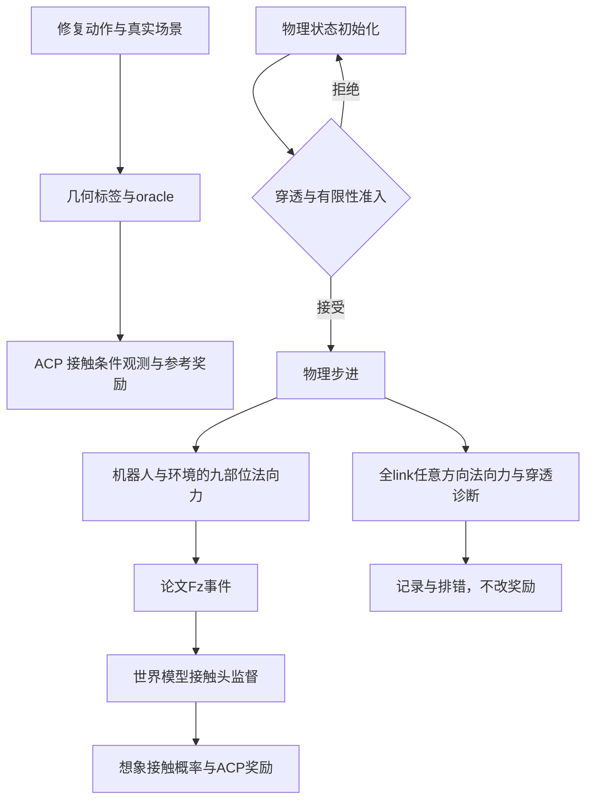

# 29DoF 数据质量与全身接触审计

本阶段保留 ACP 的14项奖励、权重、九部位定义、actor／critic 信息边界及 CSI。参考 `fullbody-climb` 的全身接触诊断和初始化几何准入，未导入 InstinctMJ 的奖励，未启动正式训练。

## 数据评估结论

“转换与标注完成”不等于“整条轨迹通过筛查”。原生转换版的关节／坐标保真已验证，Omni、LAFAN1、PHP 共325条、636091帧；六腕原值保留，腰部反号和躯干基座转换正确。但换用目标 MJCF 的真实胶囊碰撞体后，仍需修复几何与支撑。

| 原生29DoF版本 | 完成转换与评估 | 整条离线候选 | 主要未通过项 |
| --- | ---: | ---: | --- |
| Omni robot-terrain | 145/145 | 0 | 手臂与身体自碰撞、新手部碰撞体与箱体穿透、足端支撑间隙 |
| LAFAN1 | 40/40 | 0 | 手肘／双手自碰撞、少量地面穿透、支撑相滑动 |
| PHP | 140/140，地形变体0 | 0 | 环境碰撞、130条关节限位、133条自碰撞；仍不加入训练 |
| Mixamo | 2453条输入，后台继续处理 | 部分候选，不能代表全批通过 | 自碰撞、速度、座椅缺失或场景未确认等 |

可复核的生成时刻快照见 [质量审计JSON](数据快照/29DoF质量与全身接触审计.json)。实时 Mixamo 数量用 `status mixamo_instinct29` 查询；短静态片段记为 `excluded_too_short`，不算处理失败，也不伪造动作帧。坐下／爬梯的候选支撑场景不会因几何检查通过而被自动确认为真实场景。

门槛来自 `configs/data_quality.json` 的工程筛查，**不是论文规定的训练准入标准**：环境／自碰撞容差3mm、支撑覆盖90%、接触内点速度P95不超过0.15m/s、关键点均值／P95误差不超过0.08／0.15m。整个片段任何穿透或限位超标仍会拒绝。阈值本阶段未放宽。

## Omni 全量修复：145条、91095帧

**原动作已经是29DoF，主要问题是目标模型兼容性及旧评估误报，不能概括为原始数据质量差。**
原版 Omni 的骨盆基座、网格碰撞体和球手，与 InstinctMJ 躯干基座的胶囊碰撞体不是同一模型；29个关节数相同并不保证表面几何相同。
其中目标手部胶囊半径5cm、半段长2.5cm，中心在腕链局部x=7.5cm处；脚底也使用不同碰撞形状。按名称转换关节、反向腰链和根坐标后，仍可能引入新的碰撞。

### 同动作、同地形、同时间戳的模型对比

| 超过3mm的环境穿透 | 帧数 |
| --- | ---: |
| 原始Omni模型 | 2256 |
| 换到InstinctMJ模型，尚未修复 | 26643 |
| 仅换模型后新增 | 24894 |
| 两个模型中均存在 | 1749 |
| 最终修复后 | **0** |

目标模型约93.4%的环境穿透帧是模型切换后新增的。原模型的原始自接触还包含关节外壳重叠，不能直接把这些原始计数当成坏动作；相隔多个关节的身体对统计也仅作诊断，不能代替校准过的碰撞允许矩阵。修复和最终准入没有新增身体对黑名单。

对比由 `compare --run .../instinct29_v1` 生成；每条保留原／目标模型距离、九部位源几何距离和地形witness点。无需重新依赖人体关节；33条没有 human joints 的轨迹也已处理。

### 实际修复与复评结果

稳定ID **`omni_instinct29_geometry`** 现指向 `outputs/数据集/omni/instinct29_geometry_v5`。原生基线 `instinct29_v1` 保留，`v4` 是全量几何修复的上游证据，不能随意删除。全部145条完整轨迹已处理，无处理失败。

| 检查 | 未修复目标模型 | 最终v5 |
| --- | ---: | ---: |
| 环境穿透超3mm帧 | 26643 | **0** |
| 原生自碰撞超3mm帧 | 30435 | **0** |
| 关节位置／速度超限帧 | 0／0 | **0／0** |
| 整条现有离线筛查通过 | 0 | **130/145** |
| 仍触发足部速度门槛 | — | **15条** |
| 成功物理跟踪／Stage2 hindsight准入 | 未验证 | **未验证／0** |

候选数的前后口径有变化，不能把0→130全部归因于优化器。独立的穿透、关节限位和姿态保真指标仍可直接比较。
目标姿态与最终标签逐帧一致，根旋转与原生转换基线完全一致。各片段最坏关键点均值／P95误差为17.7／52.6mm，低于80／150mm门槛；基座修正P95为17.0mm，最大109.2mm。最大关节修正0.808rad，不能声称修复版仍逐关节原值不变。

第一轮用全身距离约束消除穿透。接着纠正两个统计问题：

- 低脚尖速度不代表支撑，攀爬中悬空不动的脚也会满足该条件。新支撑意图再与**原模型脚部到地形距离≤15mm**取交集；左右支撑样本由69684／70956变成53297／49408。旧标记另存，不覆盖原始数据。
- 脚底中心XY速度不等于滑动。新口径采用刚体最近表面点的切向速度，保留旧中心速度作对照。旋转脚底的回归测试验证：中心0.2m/s但无滑动滚动时，接触点速度为0；包括非零yaw的自由基座情形。

新口径记录为 `native29_geometric_support_tangent_v2`，保存在每批 `quality_criteria.json`；数值门槛仍为3mm、90%、0.15m/s等工程值。几何意图与接触点速度都不能证明实际承重或摩擦可行。

单帧消穿透也会引入跨帧抖动，因此对仍未通过的片段尝试修正量的前／后向平滑，权重3、8，共51次尝试，29条采用改善结果、116条保持首轮姿态。每次候选都重新Drake标注和MuJoCo检查，只在无新增失败项且指标改善时替换。
例如 `climb_01_z_scale_1.2` 的左脚切向速度P95由首轮0.349m/s降至约0.054m/s，仍无超3mm穿透。

剩余15条保留在 `needs_repair_clips.txt`，逐条数值见 [全量修复快照](数据快照/Omni原生29DoF全量修复.json)。其中11条为z_scale=1.2；不能笼统归咎原动作，既有原动作本身超过工程门槛的情况，也有模型适配后尚未消除的滑动。例如 `climb_03_z_scale_1.2` 原模型的近接触点速度诊断约0.180／0.177m/s，已经高于0.15m/s；这不是物理受力真值，也不证明动作错误。`climb_26_z_scale_1.2` 修复后左脚仍达0.702m/s，明确不进入候选。

### 全身接触复核：不能只看双脚

比较原模型九部位几何接近地形的所有帧，最终模型仍保持在−3～15mm范围内的比例：

| 部位 | 左／右或单部位 |
| --- | --- |
| 双脚 | 97.99%／97.55% |
| 双膝 | 92.04%／95.15% |
| 双手 | 99.77%／99.79% |
| 双肘 | 100%／100%，但仅21／34个源样本 |
| 骨盆 | **78.68%，仍需专项复核** |

这项诊断暴露了只检查双脚的筛查盲区。模型表面变化、地形接近与实际支撑不等价，不能靠全局平均把单条丢失的膝／骨盆接触掩盖掉。
现额外生成 `fullbody_contact_retention_by_clip.json`、`fullbody_contact_retention_summary.json` 和 `contact_review_clips.txt`。
明确的保守复核规则是：某部位源接近地形的**累计**样本不少于0.2s，但目标接近覆盖低于90%，即加入复核清单；累计样本不等于连续支撑段，也不是论文准入规则。

52条触发该额外复核，其中46条位于原有130条离线候选内。因此现提供 **84条保守候选** `conservative_candidate_clips.txt`，即130条中再剔除这些复核项。
原有离线候选清单保持其已记录的评估口径，不能称130条已通过完整全身支撑验证。84条也仍需要实际跟踪和接触力验证；目前不启动正式训练。

下一步针对剩余问题，应采用跨帧接触点／表面约束，并优先复核膝、骨盆接触；不能再只优化单帧穿透，也不能仅提高速度阈值或统一抬高整段动作。

完整命令、流程图和文件用途见 [29DoF使用说明](../02_数据集/G1_29DoF版本.md#omni原29dof到目标29dof的修复)。可查看 [修复片段定格](../../outputs/可视化/omni/instinct29_geometry_v5/climb01_repaired.png) 和 [待速度复核片段定格](../../outputs/可视化/omni/instinct29_geometry_v5/climb03_speed_review.png)；均为参考轨迹回放，不是RL成功／失败结果。

## 历史单片段修复试验

新增 `repair --method fullbody`，与原来的 `--method arms` 共用入口。全身方法优化基座平移和全部29个关节，固定基座旋转；用 MuJoCo 实际过滤后的接触构建距离约束，不把手工身体对黑名单当作修复。使用关节限位、原姿态／关键点保持、时间相邻修正正则、源支撑相内的足端软任务。箱角及胶囊接触特征切换时，回退到精确非线性距离约束。


| 完整片段 | 环境无效帧：前→后 | 自碰撞帧：前→后 | 修复后支撑内点速度P95：左／右 | 当前判定 |
| --- | ---: | ---: | --- | --- |
| `climb_00_z_scale_0.9`，1006帧 | 379→0 | 570→0 | 0.143／0.125m/s | **离线候选**，尚无训练／hindsight准入 |
| `walk4_subject1`，8196帧 | 100→0 | 4935→0 | 0.205／0.227m/s | **仍待修复**，保留滑动标记 |

爬箱修复后最深环境／自碰撞分别为−2.18／−2.28mm，关键点均值／P95误差14.6／43.3mm；最大关节速度比0.793。walk 修复后环境／自碰撞最低距离为−1.11／−1.60mm，关键点均值／P95误差2.9／8.9mm，最大关节速度比0.705。walk 的支撑相滑动仍超限，且比原生转换版稍高，不能把“碰撞消除”表述为“动作整体合格”。后续需要跨帧支撑点约束，不能继续靠单帧位置修复或提高速度阈值解决。

| 稳定ID | 当前目录 | 范围 |
| --- | --- | --- |
| `omni_instinct29_geometry` | `outputs/数据集/omni/instinct29_geometry_v5` | 当前完整145条；上述单条试验v3作为历史证据保留 |
| `lafan1_instinct29_geometry` | `outputs/数据集/lafan1/instinct29_geometry_v2` | 仅上述完整walk片段 |

v1及爬箱v2是未作为当前版本使用的开发试验，仍保留审计证据。第一版曾把近地摆动脚也拉向地面，最终版本把足端吸附限制到源支撑相并平滑过渡；没有批量推广这项有缺陷的约束。原生 `instinct29_v1` 与23DoF数据不被改写。修复会改变原关节，包括腕部；原生版本的逐关节保真结论不适用于修复版。

### 历史：首次滑动检查的口径修正

原评估只有 Mixamo 使用“源支撑相 ∩ 目标几何接触”；原生机器人数据仅根据目标近地接触计算，低摆动脚也可能进入速度统计。现统一在**提供源支撑标签时**取交集，并去掉接触转换的邻接样本；没有源标签时保留原保守定义。距离、速度门槛及源支撑标记本身不变。这个改变纠正统计对象，不意味着几何标签是物理支撑真值；真正的接触点切向速度、摩擦和承载能力仍需物理验证。

该历史口径保留在原生基线。Omni本次全量修复另核实了源支撑相并计算刚体接触点切向速度，见上文显式新版本。

## `fullbody-climb` 的借鉴边界

实际审查的工作树为 `/home/lyx/train/supermimic-extend/InstinctMJ-fullbody`，分支 `fullbody-climb`，基础提交 `7ca851e`。关键实现位于未提交的 `src/instinct_mj/rl/supermimic/fullbody.py` 及 runner 改动；仅比较分支提交差异会漏掉它们。快照记录了工作树状态与文件SHA256，未修改参考仓库。

| 参考工作树的处理 | ACP 本分支处理 |
| --- | --- |
| 全身攀爬取消不良接触惩罚／非法接触重置 | ACP Stage1 原本没有这些 InstinctMJ 项；继续允许合法膝、手、肘、骨盆接触，不新增“只许脚接触”条件 |
| 原生碰撞距离检查初始化，有限次重采样 | 已借鉴：写入 replay 前检查，超过30mm最多重采样8次，仍失败则停止；不记作策略失败或 CSI 失败 |
| 按身体接触、穿透、奖励分项、结束原因诊断 | 已借鉴：九部位事件＋所有有碰撞体的机器人link法向接触／冲击诊断，环境／自碰撞分开，记录14项原始奖励 |
| 固定动作组采样质量、组内自适应bins | 当前 walk／box 固定环境分组，各组分别采集和记录；不替换 ACP 的 CSI，不混入新的自适应失败采样 |
| AMASS 重置不降低已在高处的姿态 | ACP 从真实场景坐标重置，不执行“全局压到z=0”；无需移植 AMASS 的地面修正 |
| 原任务奖励和36维辅助接触头 | 不导入；保留 ACP 的9部位接触头、奖励及观测。额外link接触仅诊断，不进入actor／奖励／世界模型监督 |

### 保留论文接触定义

ACP Table 3 写明 `c_meas` 是 sensor-history 窗口内竖直接触力幅值超过1N。当前仍沿用4个物理子步内 `max(abs(Fz)) > 1N`；4步窗口是既有工程选择，论文未规定此窗口长度。

采集器已限定为**机器人—环境接触**，自碰撞不能被当作正确环境支撑。九部位仍为双脚、双膝、双手、双肘和骨盆，固定碰撞后代并入对应部位。另存任意方向的标量法向力和，避免水平墙面接触和相反方向力抵消在诊断中被隐藏；同时监测九部位之外的躯干等碰撞link。

这里保留原后端的世界法向力映射，不等同于包含摩擦切向分量的总接触力。纯水平法向接触不会触发论文Fz事件。新的标量法向力、500N冲击、全link诊断不进入奖励或接触头监督，不能用它们悄悄改写论文。运行时自碰撞若在物理配置中关闭，其自碰撞诊断也为零，不能替代离线原生模型的自碰撞核验。



摔倒撞箱属于真实动力学事件，世界模型应学习它；它不因此成为正确参考接触，更不能绕过“成功tracker回放”进入 Stage2 hindsight。当前所有版本 Stage2 hindsight 准入仍为0。

## 使用与验证

```bash
# 查看真实状态、复评、回放修复版
.venv/bin/python scripts/acp_pipeline.py status mixamo_instinct29
.venv/bin/python scripts/acp_pipeline.py evaluate omni_instinct29_geometry --workers 2
.venv/bin/python scripts/acp_pipeline.py view omni_instinct29_geometry \
  --clip climb_00_z_scale_0.9 --show-source

# 生成新的修复试验；使用新的独立输出目录，避免覆写已有版本
.venv/bin/python scripts/acp_pipeline.py repair --method fullbody \
  --baseline outputs/数据集/omni/instinct29_v1 \
  --output outputs/实验归档/native29/omni_fullbody_new \
  --clips climb_00_z_scale_0.9 --workers 1 --passes 2
```

`fullbody` 会自动重标注、原生核验和评估；不需要再运行23DoF的 `finalize`。省略 `--clips` 会处理输入清单全部片段，故应使用已完成的原生29DoF批次。`--maximum-frames` 仅用于开发前缀，不执行完整片段准入。代码／模型／参数指纹改变时使用新输出目录；只重做质量筛查用 `evaluate`。原始模型与地形仍由基线提供，迁移时需一并携带或重新打包。

本机 MuJoCo／Torch 环境19项针对性测试通过，包括全部九部位、水平手撑墙、自碰撞排除、相反法向力、九部位以外的link、过期packed槽、接触Jacobian、箱角非线性回退、初始化拒绝与replay隔离、原ACP观测和有限梯度。Drake环境全套38通过、19因依赖／外部环境跳过。CPU冒烟 `fullbody_audit_cpu_v2` 的actor／critic仍为468／353，世界模型与策略梯度有限，optimizer steps=0；未验证CUDA吞吐或收敛。

**数据版本和训练后端分别管理**：本次29DoF修复未把既有23DoF训练模型、动作维度或便携包静默切换到29DoF。后端目前仍使用23DoF、ACP奖励＋SuperMimic优化；29DoF训练接入需要独立的配置与验收。
