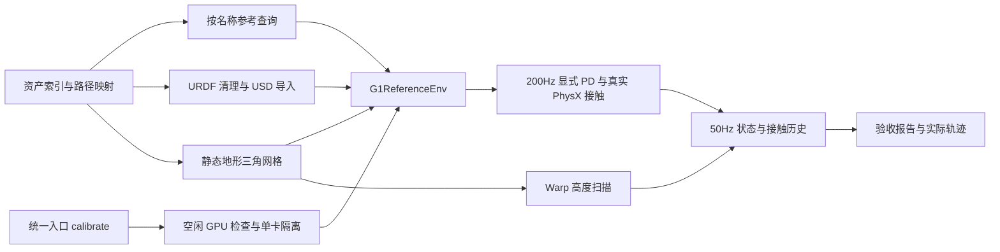

# M2：仿真与机器人校准

2026-10-30：G1-23 球手模型的最小 IsaacLab 环境完成验收，可以进入 M3 / Stage 1 接触条件 Tracker。此阶段交付物是物理环境和数据／控制接口；PPO、奖励、CSI 和训练网络在 M3 实现。

## 运行方式

在已配置的远端训练机执行：

```bash
cd /home/hitcsc/ACP_repro
/home/hitcsc/miniconda3/envs/isaaclabv2.2/bin/python \
  scripts/acp_pipeline.py calibrate --gpu 0 \
  --num-envs 1 16 64 --policy-steps 500 --render
```

`--gpu` 是物理编号或完整 UUID。入口使用 `simulation_python`，检查目标卡现有计算进程，按 UUID 隔离 CUDA 并关闭 Kit 多卡。当前只使用物理 GPU 0；GPU 1 上其他项目的训练继续运行。安装和路径说明见 [远程 M2 准备](../01_使用指南/远程M2准备.md)。

每次新建 `outputs/实验归档/m2/<UTC时间>/`；`--output` 可指定尚不存在的目录，避免覆盖证据。默认 200 个控制步即 4 秒；验收使用 500 步即 10 秒。

已有 NPZ 需要重新导出视频时，使用同一入口 `calibrate --gpu 0 --render-only --output <已有验收目录>`，不重跑物理测试。首次导出曾因源模型默认离屏 framebuffer 太小而失败；已显式设置渲染尺寸并成功重导出，原失败日志与退出码保留在本次证据目录。

可用 `--asset omni/lafan1/mixamo/php` 或批次 ID、`--clip <ID>` 选择已有标注轨迹。默认 Omni 的 `climb_00_z_scale_0.9`。这次物理验收使用该片段及其真实地形，未对整个数据集逐条验证动力学可执行性。

## 数据到物理环境



核心文件：

| 文件 | 职责 |
| --- | --- |
| [configs/m2.json](../../configs/m2.json) | 显式关节顺序、姿态、增益、限幅和碰撞配置 |
| [reference.py](../../src/acp/envs/reference.py) | 按名称重排，线性运动学插值与四元数 SLERP |
| [conversion.py](../../src/acp/envs/conversion.py) | 保留质量惯量的模型清理、碰撞网格和接触分组 |
| [g1.py](../../src/acp/envs/g1.py) | 批量 reset/step、接触、扫描、本体状态与历史 |
| [calibrate.py](../../src/acp/envs/calibrate.py) | 物理验收、显存采样、报告和轨迹导出 |

## 固定接口

| 接口 | M2 约定 |
| --- | --- |
| 物理／控制频率 | 0.005 秒一步，decimation=4，即 200Hz／50Hz |
| 动作 | `[N,23]`，`q_target=q_default+0.25*action`；有限动作裁剪至 ±100 |
| 关节顺序 | 左腿 6、右腿 6、腰 3、左肩肘 4、右肩肘 4；以配置中的名称为准 |
| 本体状态 | `[N,75]`：body 系根角速度 3、重力投影 3、相对关节位置 23、关节速度 23、上一动作 23 |
| 历史 | `[N,5,75]`，旧→新；reset 用当前状态填满，上一动作初始化为参考关节目标的逆映射 |
| 接触顺序 | 左脚、右脚、左膝、右膝、左手、右手、左肘、右肘、骨盆 |
| 接触力 | 世界系净力 `[N,9,3]`，每个控制周期保留 4 个物理子步 `[N,4,9,3]`，旧→新 |
| Tracker 扫描 | 9×7，共 63 点，x±0.4m、y±0.3m，间隔 0.1m |
| Planner 扫描 | 17×11，共 187 点，x±0.8m、y±0.5m，间隔 0.1m |
| 扫描坐标 | 随根 yaw 旋转；x-major/y-minor；返回 tile 世界坐标命中点、相对根高度及 valid mask |
| 重置 | 根 link 位姿、世界系线／角速度、关节位置／速度均从参考写入；不把 COM 速度当 link 速度 |

PhysX 导入后的关节顺序实际交错排列，不能假定与 NPZ 相同；全部读写按名称映射。九部位 landmark 与离线标签保持一致，双脚使用 link 系 `[0,0,-0.03]m`，其他为 link 原点。接触力聚合该部位和其固定子链，但遇到另一语义部位停止继承，避免手／肘或骨盆重复计数。

参考文件保留原始采样时间；查询时夹紧片段边界。接触 flag 和已有 future 标签使用前一帧保持，不做数值插值。M3 如使用非原始时间格点的 oracle，应按查询姿态重新计算其 body-yaw 接触目标；本阶段不把离散标签保持误称为任意时刻的精确 oracle。

## 模型与工程配置

原数据集模型、manifest 和标注文件未改写。导入副本位于 `outputs/缓存/m2/<模型与配置哈希>/`：

1. 删除没有 inertial 的固定叶节点，例如 IMU、相机、辅助 foot frame；其 visual/collision 按固定变换搬到父 link。保留所有有惯量的固定 link，总质量约 **35.053142kg**。
2. 保留球手和肘等独立刚体。当前导入器即使指定非 instanceable 仍生成实例引用，环境先取消实例化，再显式创建源碰撞体。原导入器碰撞体禁用，避免双份接触。
3. 球体使用解析球碰撞，其他机器人形状使用源几何的 convex hull；圆柱由三角网格近似。地形使用静态原始三角面，与扫描共用几何，不用高度图代替箱体或垂直表面。
4. 自碰撞关闭，所有机器人部位仍与环境碰撞；摩擦 0.8、恢复系数 0、contact offset 2mm、rest offset 0，求解器位置／速度迭代 8／4。这是当前工程基线，不能声称等同作者未公开的碰撞过滤。
5. `q_default`、腰部／手臂增益、力矩和速度限制初始化参考 ASAP 配置；六腕仍固定。**腿部覆盖为 Kp=400、Kd=10**：原 ASAP 增益在本次模型／PhysX 组合中默认站立会向前倒，调整后通过 10 秒验收。原始 ASAP 增益另存 `asap_kp/asap_kd`，覆盖理由写入配置。这些不是论文披露的 PD 值，Stage 1 跟踪训练需继续校验。

每环境复制同一静态场景，tile 按 16m 间隔排列，平面总范围 1000m。当前为小批量校准布局；M3 多任务地形需根据场景包围盒安排 tile 和碰撞隔离，不能直接把该固定布局视为大规模混合场景调度器。

## 验收方法与结果

证据目录：远端 `/home/hitcsc/ACP_repro/outputs/实验归档/m2/acceptance_20261030/`。验收从隔离开发目录 `ACP_repro_m2_dev` 启动，其 outputs 链接到主仓库；JSON 保留实际启动路径。本机保存同名证据目录。运行环境为已记录的 Isaac Sim 5.1.0、PyTorch 2.7.0+cu128 与现有修改版 IsaacLab，未修改共享仿真库。

| 检查 | 结果 |
| --- | --- |
| 1／16／64 环境 | 均通过全部检查，各连续站立 10 秒，无非有限本体状态 |
| 根高度／倾斜 | 最低约 0.782m，最大重力 xy 范数约 0.077（约 4.4°） |
| 平面几何穿透 | 源碰撞顶点每 10 控制步抽样，最差约 0.2mm；不是任意地形全时段穿透保证 |
| 参考随机重置 | 每环境 8 帧；根与关节状态／速度误差在阈值内，64 环境 landmark 最大误差约 0.031mm |
| 质量与限位 | 导入质量与源模型一致；关节位置／速度／力矩限制逐名称核对 |
| 执行器饱和 | 极端动作触发全部 23 关节限幅，最大力矩 139Nm，未超配置限制 |
| 九部位接触 | 每部位逐一放置物理夹具，所有环境均测到大于 1N 的力，分组无串位 |
| 接触方向 | 静止双脚 Z 支撑力合计约 344N，与模型重量一致 |
| 地形配准 | PhysX 实际碰撞射线与 Warp 扫描抽样高度差约 2μm |
| 短参考 PD replay | 25 控制步，实测步长 0.02 秒，状态有限，单环境关节 RMSE 约 0.018rad |

夹具使用悬空站姿，其他部位从下方 1mm 间隙靠重力接触；膝的底部被小腿／脚遮挡，所以从可访问的顶部放置 3mm 重叠的校准块。膝夹具约 1.9kN 的瞬时脉冲只验证传感器映射，不作为正常运动负载或训练性能证据。

吞吐记录的是带状态拷贝与检查的环境控制步总和，不包含 PPO：本次验收约 54／804／2810 env-policy-steps/s（1／16／64 环境）。GPU 进程启动前桌面占用约 1.1GiB，本次额外峰值约 2.8GiB，报告分别保存 baseline、total 和 increment；Torch allocator 数字不是整个 Isaac Sim 显存。

每档子目录包含 `run.log`、`worker.json`、`stand_rollout.npz`、`reference_replay.npz`。总报告检查子进程退出码和所有断言。worker 记录实际模型／USD／场景／动作／配置的 SHA-256、关节／刚体顺序、设备和完整参数。`--render` 另输出单环境 MP4、PNG；视频来自实际 PhysX 状态，MuJoCo 只负责渲染，没有执行替代动力学。

本机证据：[总报告](../../outputs/实验归档/m2/acceptance_20261030/report.json)、[10 秒站立视频](../../outputs/实验归档/m2/acceptance_20261030/envs_1/stand_rollout.mp4)、[短参考 PD 视频](../../outputs/实验归档/m2/acceptance_20261030/envs_1/reference_replay.mp4)。outputs 通过 SSH 同步，不进入 Git。

本机自动测试：34 passed、7 skipped。两个新增测试覆盖按名称重排／SLERP／离散标签与 URDF 固定叶节点几何搬运；真实 PhysX 数值行为由上述远端验收覆盖。

## 交接给 M3 / Stage 1

下一步先选一个低难度动作，接入训练任务：468 维 actor、353 维特权 critic、论文奖励、PPO、CSI 和终止／成功判据。先证明单片段从头执行成功率上升，再扩到多动作和多接触技能。M2 的未训练短 PD replay 只证明数据和执行器通路可用，不证明爬箱或坐下已经能由策略完成。
