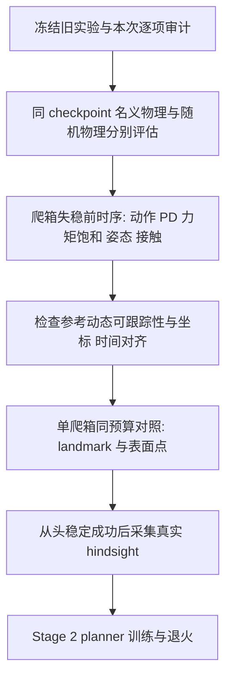

# M3 / Stage 1：RL 配置与论文逐项审计

审计日期：2026-11-03。对象为已经完成的 `20261030_2048env_10000iter_table_s2_v1`，不是接触点来源候选配置。结论：**主要算法接口与论文一致，但实验整体并不完全一致；当前爬箱失败不能归结为接触点来源，更不能把摔倒撞箱当作正确撑箱。**

## 1. 审计依据与范围

- 论文：[本地 PDF](../../assets/papaer/2610.31608v1.pdf)，主要核对正文 pp.12–16、Table 3（p.19）、Table S2（p.21）、Table S4（p.22）和 Table S6（p.25）；[可检索文本](../04_论文与复现/论文资料/2610.31608v1.layout.txt)。页码为 PDF 中印出的页码。
- 历史训练：[provenance.json](../../outputs/实验归档/stage1/walk_box/20261030_2048env_10000iter_table_s2_v1/provenance.json)、[最终评估](../../outputs/实验归档/stage1/walk_box/20261030_2048env_10000iter_table_s2_v1/evaluation/iteration_010000/report.json)、保存的 PhysX 状态和接触力。
- 训练源码按 provenance 哈希回溯到 `3c9ee4c`，9 个源码／配置文件全部匹配；25 个公开奖励权重和 PPO 参数比较全部通过。当前源码后来增加了可选 `environment_surface`，**已完成训练使用的仍是 `body_landmark`**；不能拿候选配置解释旧训练。
- “对齐”表示能对应论文公开的参数或公式；“明确不同”表示已知实验差异；“未公开”表示当前工程实现有依据但无法证明与作者相同。没有作者代码，不以维数相同代替语义一致。
- 本次没有启动新训练、没有更换奖励、终止条件、PD 或接触点来源。以下是离线审计，不是新的学习效果结论。

## 2. 失败视频复核：是失稳后的碰撞

[原始对照视频](../../outputs/实验归档/stage1/reports/20261103_walk_box/box_010000_from_start.mp4)左侧为实际执行，右侧为参考，MuJoCo 仅渲染保存的 PhysX 状态。

| 实际片段时间 | 基座倾斜角 | 根高度 | 事件 |
| --- | --- | --- | --- |
| 1.00 s | 4.6° | 0.778 m | 尚接近直立 |
| 1.50 s | 18.1° | 0.743 m | 已明显向前失稳 |
| 2.00 s | 40.4° | 0.710 m | 撞箱前已大幅倾斜 |
| 2.26 s | 46.5° | 0.572 m | 右手第一次超过 1 N，同时出现约 292 N 峰值 |
| 2.98 s | 39.8° | 0.597 m | 左手出现约 85 N 峰值，仍处于失败过程 |
| 3.16 s | — | — | 根位置误差约 0.777 m，越过当前 0.75 m 工程阈值后终止 |

这里的倾斜角是基座局部 z 轴与世界 z 轴夹角，**不是终止条件中的实际／参考姿态误差**。右手撞箱早于参考右手 onset 约 2.78 s；参考左手 onset 约 2.74 s，实际左手冲击在其后。不能把两只手都说成提前碰撞，也不能把一次冲击峰值说成持续支撑。

另一项更正：本实验远端安装的 Isaac Lab `v2.2.1-65-g3a0db9d761` 中，`ContactSensor.data.net_forces_w` 是**法向接触力在世界坐标中的向量和，不含切向摩擦力**。已直接检查远端 `source/isaaclab/isaaclab/sensors/contact_sensor/contact_sensor_data.py`，也可参照[官方 v2.2.1 源码](https://github.com/isaac-sim/IsaacLab/blob/v2.2.1/source/isaaclab/isaaclab/sensors/contact_sensor/contact_sensor_data.py)。这个结论针对当前运行版本，升级 Isaac Lab／后端后需要重新确认，不能推广到所有版本。之前报告称其为“三维合力”不准确，现已修正。左右手峰值的竖直分量几乎为零，只能说明记录到的法向力主要水平，不能证明没有竖直摩擦支撑。论文没有公开作者具体如何配置该传感器，不能断言作者同样丢掉或包含了切向力。

本视频是保存的第一个爬箱环境，不能将它的详细失败时序推广到全部 1,024 个环境；总体从头完成率 0/1,024 来自独立批量统计。

## 3. 总览

| 项目 | 结论 | 关键说明 |
| --- | --- | --- |
| Actor / critic 维数和 MLP | 对齐 | 468 / 353，512→256→128，ELU，23 维动作 |
| Actor 不输入参考关节／速度 | 对齐 | 参考运动学仅供 critic 和奖励；actor 有 oracle 接触与目标指令 |
| 本体历史、高程图、目标编码 | 公开参数对齐 | 5 步历史，9×7 / 17×11，0.1 m；部分坐标／噪声实现未公开 |
| Stage 1 的 14 项奖励 | 公开公式和权重对齐 | 含控制步长乘法、移动门控、接触判据；具体传感和差分约定未公开 |
| PPO 主要参数 | 对齐 | Table S6；初始化、归一化和 KL 调整细节不能确认完全一致 |
| CSI | 对齐 | 初始 0.9，达到 0.99 算完成，调整 ±0.05，范围 [0,0.99] |
| 随机化 | Table S2 范围已实现 | 动力学写入／回读通过；注入位置、采样粒度存在工程解释 |
| 训练规模和数据覆盖 | 明确不同 | 单卡 2,048 环境、两段已见动作；论文每 worker 12,000 环境、多种动作／地形 |
| 评估协议 | 明确不同 | 当前评估保留随机动力学和动作延迟；论文所述仿真 benchmark 关闭它们 |
| 终止条件、PD、碰撞与模型细节 | 未公开，工程选择 | 不能宣称与作者完全相同；需要单独核验控制可跟踪性 |
| 先另训 mimic 才能开始 Stage 1 | 不需要 | 正文先做几何接触标签，再训练 contact-conditioned tracker；hindsight 属后续 planner 监督 |

## 4. 观测、坐标和高程图

代码：[本体／高程扫描](../../src/acp/envs/g1.py)、[Stage1Task.observations](../../src/acp/envs/stage1.py)、[TensorReference.contacts](../../src/acp/training/task.py)。

### Actor：468 维

| 流 | 当前实现 | 对照 |
| --- | --- | --- |
| 本体历史 375 | 每步：机体系角速度 3 + 投影重力 3 + 相对默认角度 23 + 关节速度 23 + 上一策略动作 23 = 75；堆叠 5 控制步 | 公开结构对齐 |
| 局部高程 63 | 9×7，间距 0.1 m，覆盖 0.8×0.6 m；yaw 对齐、根高度相对值 | 公开网格对齐；具体高度归一化／裁剪约定未公开 |
| 接触指令 27 | 九部位各 xyz；未来 1.5 s 内的下一次 onset，在当前估计基座 yaw 系中表示；缺失／超出 footprint 为零 | 公开接触接口对齐；历史使用 onset 身体 landmark，表面 witness 是未验证候选 |
| 目标 3 | 未来 U(0.5,1.5) s 的参考目标，末端截断；xy 除以 max(距离,0.3 m)，相对 yaw wrap 到 [−π,π) | Table S4 对齐；当前确定性评估固定 lookahead=1 s，是额外工程约定 |

Actor 不接收参考 q、q̇、根线／角速度，也没有动作类别 ID。参考关节被扰动时 actor 不变、critic 改变的隔离检查已经接入训练启动流程。Oracle 接触与参考采样目标是论文允许的 Stage 1 输入，不能把“不输入参考运动学”解释为 Stage 1 完全不使用参考动作。

### Critic：353 维

`75 当前无噪声本体 + 187 无噪声高程 + 3 基座线速度 + 52 参考运动学 + 27 参考身体位置 + 9 参考接触标签 = 353`。

- 参考运动学：参考线／角速度各 3、q 23、q̇ 23。当前将参考速度转到参考完整 body 系；27 维参考身体位置转到**当前实际**基座 yaw 系，以保留位置跟踪误差。
- 这些 critic 流和总维数与正文一致，但论文没有明确所有流的坐标约定，当前变换不能标成“已证实与作者相同”。
- 奖励的 body-yaw 变换另算：实际和参考各使用自己的基座姿态，这一点是 Table 3 明确要求，当前实现对应。

### 高程来源与感知边界

高程图确实存在：从与实际碰撞场景对应的静态三角网格射线采样，不是占位常数。Actor 为 9×7，critic 为 17×11；后者在 Stage 1 是 privileged 高程，不能误称已经训练了 planner。当前没有 LiDAR 输入、神经建图、遮挡和真实传感器重建；论文仿真里的高程条件与完整实机感知系统需要分别验收。

## 5. 网络与 PPO

代码：[ActorCritic、GAE、PPO](../../src/acp/training/ppo.py)。

| 项目 | 论文 | 历史运行 | 结论 |
| --- | --- | --- | --- |
| Actor / critic 隐藏层 | 512,256,128 / ELU | 相同，两套独立 MLP | 对齐 |
| Actor 输出 | 23 | 23 维 Gaussian 均值 | 输出维数对齐；分布细节未公开 |
| Rollout 步数 | 24 | 24 | 对齐 |
| Epoch / minibatch 数 | 5 / 8 | 5 / 8 | 对齐 |
| Policy clip / value coefficient | 0.2 / 1 | 相同 | 对齐 |
| 梯度上限 | 1 | 1 | 对齐 |
| γ / GAE λ | 0.99 / 0.95 | 相同 | 对齐 |
| 初始学习率 / target KL | 1e-4 / 0.02 | 相同 | 对齐 |
| 学习率策略 / entropy coefficient | KL-adaptive / 0.006 | 相同 | 公开参数对齐 |
| 每 worker 环境数 | 12,000 | 2,048 | 明确不同 |
| 每 worker rollout batch | 288,000 | 49,152 | 仅为论文单 worker 的约 17.1% |
| 每 worker minibatch | 36,000 | 6,144 | 明确不同 |

当前优势按完整 rollout 归一化，GAE 在跟踪失败时不 bootstrap、到达片段终点时 bootstrap，但递推不越过 reset 边界。它们符合通常的 PPO 实现及论文公开的优势归一化说明；作者对终点的价值约定没有完整公开。

下列为当前明确记录的工程选择，不能声称论文已指定：运行均值／方差归一化且裁剪到 ±10；Gaussian 初始标准差 0.5，log_std 限制 [−5,2]；正交初始化，隐藏 gain √2、actor 输出 gain 0.01；value clipping 开启，范围 0.2；KL 每 minibatch 按 2×／0.5×阈值调整学习率、倍率 1.5、边界 [1e-5,1e-2]。

当前 10,000 次更新对应 **491,520,000 个训练 transitions**。论文正文提到 Stage 1 使用 3×4090 约一天，但 Table S6 特别注明没有报告 Stage 1 分布式总量；不能擅自用 3×12,000 当成已确认的同步总 batch，也不能认为相同更新次数就是相同训练预算。扩大环境数会改变 batch、更新次数和优化统计，不能单独保证解决爬箱。

## 6. 奖励：14 项逐项核对

代码：[rewards](../../src/acp/training/task.py)、[加权和与终止](../../src/acp/envs/stage1.py)。表中权重来自训练 provenance，与 Table 3 Stage 1 一列逐项一致。

| 项 | 权重 | 公式核对重点 |
| --- | --- | --- |
| track_base_pos | 3 | exp(−χmov·位置误差平方/0.5² − 姿态误差平方/1²) |
| track_base_vel | 1 | 线速度核尺度 1，角速度核尺度 3 |
| track_joint_pos | 2.5 | 角差 wrapπ 后平方和，尺度 2 |
| track_joint_vel | 0.5 | 速度差平方和，尺度 10 |
| track_contact_label | 5 | 九部位平均 c_meas·(2c_ref−1) |
| track_contact_pos_base | 2 | 各自基座 yaw 系的九部位误差平方和，尺度 1 |
| track_contact_pos_global | 1 | 世界系九部位误差平方和，乘移动门控，尺度 1 |
| action_rate | −0.1 | 一阶动作差平方和 |
| action_rate_2nd | −0.05 | 二阶动作差平方和 |
| joint_torque | −1e-5 | 应用力矩平方和 |
| torque_limits | −0.001 | computed 与 applied 力矩绝对差之和 |
| dof_pos_limits | −10 | soft limit 越界量求和，最大 30 |
| dof_vel_limits | −1 | 超过 90% 速度上限的部分，各关节裁剪到 [0,1] 后求和 |
| contact_acc | −0.01 | 世界系九部位加速度范数求和，最大 1e4 |

- 每步总奖励乘控制 dt=0.02 s；χmov 使用参考基座速度模长 >0.1 m/s。Stage 1 没有启用 planned-contact、goal-reaching 与 Stage 3 style 项，这是正确的阶段设置。
- `c_meas` 为最近四个 200 Hz 子步任一 `|Fz|>1 N`。Table 3 明确使用竖直力大小，而不是三维力模长；奖励中并没有把 `c_ref` 当作“真实测量”。论文没有给出传感历史具体长度。
- **0.2 s 过滤主要用于几何标签处理和后续 hindsight 的事件筛选，不是额外套在每步接触奖励上。** 现有接触审计图为了比较，对测量曲线也过滤 10 个控制步，不能拿该图直接当作未过滤的每步奖励输入。
- 接触位置奖励跟踪的是身体 landmark，不只在 active contact 部位计算；Table 3 该两项没有 contact mask。不能未经说明把身体位置整体替成环境表面点。
- contact_acc 当前用 50 Hz 位置二阶差分，reset 后前两步设零。作者没有公开差分／滤波方式；这会影响数值分布，应通过日志验证，而不是称为已知论文 bug。

因此目前没有证据支持“奖励项漏了，所以爬箱失败”。更需要核验的是输入坐标、实际执行器能力、参考动态可实现性和失稳前各奖励／力矩的时序。

## 7. 随机化：范围对齐与实现解释

代码：[Randomization](../../src/acp/envs/randomization.py)。以下均以历史 provenance 的实际参数为准，而非仅检查开关。

| 分组 | Table S2 与当前对应范围 |
| --- | --- |
| 材质 | 静／动摩擦各 U(0.3,1.2)，地面摩擦 1；恢复系数 U(0,0.5) |
| 质量／质心 | 躯干加 −2…4 kg；腿质量 ×0.85…1.15；躯干 CoM x±0.025 m，yz±0.05 m |
| 执行器 | armature、kp、kd 各 ×0.9…1.1；零位非踝 ±0.01 rad、踝 ±0.03 rad；动作延迟 0…20 ms |
| 本体噪声 | 角速度 ±0.05、投影重力 ±0.0125、关节角 ±0.01、关节速度 ±1.5 |
| 指令噪声 | 有效接触坐标 ±0.1 m；目标方向角／yaw ±0.2 rad |
| 外感知 | tracker 高程均匀 ±0.1 m；里程计延迟 50…100 ms、XY 半径 0.05 m 圆盘、Z±0.05 m |
| 初态 | 参考关节角 ±0.2 rad、根高度加 0…0.05 m；Stage 1 相位由 CSI 控制 |

动力学按环境在启动时采样、reset 后保留；mass、inertia、CoM、material、armature、显式 kp/kd 的写入回读和 reset 不变性已有记录。这里能证明参数实际写入，不能证明物理行为与作者相同。

仍需标注的解释：

1. 动作延迟按 200 Hz 四舍五入为 0/5/10/15/20 ms；不是连续时间延迟。
2. 里程计延迟／漂移每 episode 采样，作用于 actor 高程采样和 oracle／goal 坐标变换；critic 保留真值。论文没有完整描述各流注入位置。
3. 关节零位偏置加在 PD target，本体 q 仍相对名义默认姿态；作者没有公开注入约定。
4. 当前按 Table S2 给 tracker 使用均匀高程噪声；正文 p.16 又概述 Gaussian 高程噪声与 episode 高度偏移，和表格存在解释空间，不能同时宣称两种表述都逐字复现。planner 的 17×11、σ=0.03 Gaussian 噪声预留给 Stage 2；Stage 1 的 privileged critic 高程保持干净。
5. 腿 link 范围、惯量随质量同比例缩放、各环境共享一个材质三元组，是记录在案的工程约定；作者未提供完整资产配置。

## 8. 控制、碰撞、终止与数据

| 项 | 当前实现 | 审计结论 |
| --- | --- | --- |
| 控制频率／动作 | 50 Hz，23 维位置偏移 ×0.25，加默认角；200 Hz PD | 正文 p.13 对齐 |
| 腿 PD | kp=400、kd=10，叠加 Table S2 比例扰动 | M2 站立校准值；作者未公布精确 PD，不能保证相同 |
| 其他 PD、默认姿态、力矩／速度上限、armature | 冻结于 provenance.robot_config / effective_robot_config | 源于现有 G1／ASAP 配置，未获作者逐项验证 |
| 模型 | 23DoF 球手，六腕固定 | 外形和关节数对应，不代表质量、惯量、碰撞形状完全一致 |
| 碰撞 | 自碰撞关闭；身体凸包／球；接触 offset=2 mm；solver 8/4 | 作者未公开同等配置，需独立验收 |
| 失败终止 | 根位置误差 >0.75 m 或实际／参考姿态误差 >1.5 rad | 工程阈值；无单独低根高度、摔倒或非预期身体碰撞终止 |
| 成功／CSI | 达到参考 99% 且未触发失败；每环境成功相位 −0.05、失败 +0.05，范围 [0,0.99] | CSI 公开参数对齐；失败定义本身未获作者确认 |
| 数据与采样 | 固定一半 walk、一半 box；6 s 行走、20.1 s 爬箱；两个片段带明确质量 override | 用户允许的两片段实验，不能当作论文完整训练分布 |

**终止阈值允许机器人先大幅失稳再结束。** 视频中约 46° 的基座倾斜角也不等于相对参考姿态误差达到 1.5 rad。这可以解释为什么失败轨迹还能记录后续撞箱；但不能单凭这一点断言“加严格摔倒终止就能学会”，更不能将随意新增终止条件称为论文原配置。

## 9. 评估协议的确定差异

当前 [evaluate](../../src/acp/training/runner.py) 冻结网络、确定性动作，关闭 actor 噪声及 reset 扰动，但保留启动时采样的物理参数和动作延迟。论文 p.6 的仿真 benchmark 明确关闭 sensor noise、physics randomization、action delay。

因此当前 walk 99.90%、box 0% 是**随机物理实例上的已见动作诊断**，不是与论文直接可比的 benchmark 数字；两片段的成功判据也不是论文全部 unseen-terrain benchmark 的目标到达指标。已有统计没有作废，但必须准确命名。

后续应为同一个 checkpoint 分别保留两种评估：名义动力学／零延迟作为论文条件诊断；随机动力学／延迟作为鲁棒性诊断。名义评估需要构建名义参数环境，不能仅切 `evaluating=True` 或停掉噪声就宣称动力学已恢复。

## 10. 修复与验证顺序

先保留论文奖励和随机化版本作为基线，不同时改多个因素。下一轮诊断补充逐关节动作、目标、computed/applied torque、限幅比例和参考状态；现有保存回放没有完整的动作／力矩序列，不能伪造这些曲线。需要新回放或短诊断采集，随后再决定 PD、终止条件或点源的单因素实验。

Stage 1 不需要先额外训练 mimic 再造接触。正确流程仍是：运动学重定向与几何标签 → reference-contact tracker → 成功真实 rollout → hindsight planner 监督。参考环境进入 hindsight buffer 的论文标准是初始化位于前 10% 且到达至少 90%；仅尾段成功或摔倒撞箱不满足要求。

## 11. 产物与维护

- [总评估 HTML（内嵌视频与审计摘要）](../../outputs/实验归档/stage1/reports/20261103_walk_box/index.html)。
- [接触时序 HTML 与姿态／冲击证据](../../outputs/实验归档/stage1/reports/20261103_contact_audit/index.html)。
- [机器可读源码回溯与配置核对](../../outputs/实验归档/stage1/reports/20261103_rl_audit/rl_config_audit.json)。
- 本阶段只修正报告解释和增加审计证据；训练策略行为保持原样。名义物理重新评估、逐关节诊断和点源成对训练尚未执行，不将其记为已完成。
- 验证：报告／接触相关现有测试 7 passed；以 SciPy 独立旋转矩阵核验倾斜角，两份报告 JSON 的事件证据一致，总 HTML 保留 4 段内嵌视频。`check --manifests` 通过：34 份 Markdown、219 个本地链接、40 个登记批次、2,629 个完成 manifest，无错误。
