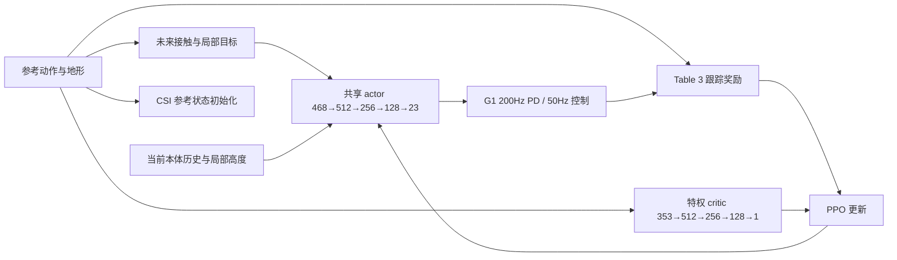

# M3 起步：walk 与 Box climbing 的共享 Tracker

本阶段先用 LAFAN1 和 OmniRetarget 各一个片段训练同一个 Stage-1 Tracker，PHP 明确排除。两个单任务冒烟和混合任务冒烟已经完成：真实 PhysX rollout、PPO 更新、checkpoint、从头／尾部评估均可运行。**流程通过不等于策略已收敛，M3 尚未整体验收。**

## 参考轨迹到底给不给

按论文 p.13、p.16、Table 3 和 S4：actor 不看参考关节、参考根运动学或技能编号；它接收当前本体历史、地形、oracle 未来接触位置与局部目标。参考轨迹仍用于奖励、特权 critic 和 CSI 重置。Stage 1 尚未训练 ACP，不能去掉 oracle 后仍称为论文 Stage 1。



当前默认配置开启 Table S2 的 Stage 1 随机化；历史关闭随机化的实例仅用于基础跟踪对照。随机化细节和证据见下文。

启动前还会做物理任务的观测隔离检查：只改变参考关节，要求 actor 输入逐元素不变、critic 输入改变，结果写 `observation_contract.json`。

## 本轮数据与参数

| 项目 | 本轮选择 |
| --- | --- |
| walk | `lafan_asap23 / walk4_subject1`，原时间 22–28 秒，共 6 秒 |
| Box climbing | `omni_asap23_arm_repair_smooth / climb_00_z_scale_0.9`，0–20.1 秒 |
| 策略 | 一个共享 actor 和 reference critic；`walk_box` 环境按约 1:1 固定分配两种参考及各自真实场景 |
| 排除 | PHP；本轮也没有混入其他 Mixamo／LAFAN 动作 |
| 控制 | 沿用 M2 显式 PD 和 23 个按名称映射的关节 |
| PPO | 原生 PyTorch 实现；rollout 24、epochs 5、minibatches 8、γ=0.99、λ=0.95、clip=0.2、初始 lr=1e-4、KL target=0.02、entropy=0.006 |
| CSI | 初相位 0.9；每环境成功完成到 0.99 则向前推进 0.05，否则后退 0.05，限制 [0,0.99] |
| 常规首轮规模 | 2,048 个环境、10,000 次 PPO 更新，约 4.9152 亿 transitions；以实际启动记录为准 |

完整机器可读配置见 [stage1.json](../../configs/stage1.json)。现有离线报告均保留原 `needs_repair` 状态；本轮通过配置里的 `experimental_data_override` 明确允许小范围可学习性实验，没有修改质量报告或将整个数据集自动批准为训练数据。

## 启动、状态和续训

远端执行：

```bash
cd /home/hitcsc/ACP_repro
PY=/home/hitcsc/miniconda3/envs/isaaclabv2.2/bin/python

# 同一策略同时学习两个片段；仅用物理 GPU 0
$PY scripts/acp_pipeline.py train --task walk_box --gpu 0 \
  --num-envs 2048 --iterations 10000 \
  --eval-interval 100 --save-interval 100 --keep-checkpoints --background

# 单任务排错仍用同一个入口
$PY scripts/acp_pipeline.py train --task walk --gpu 0 --num-envs 16 --iterations 2
$PY scripts/acp_pipeline.py train --task box --gpu 0 --num-envs 16 --iterations 2
```

每次创建新目录 `outputs/实验归档/stage1/<task>/<UTC时间>/`。`--output` 可指定尚不存在的目录。后台返回后，检查 `background.json`、`launch.json` 和 `run.log`，不能只凭父进程返回 0 认定训练成功。目标卡已有计算任务时会拒绝启动。

```bash
tail -f <训练目录>/run.log
cat <训练目录>/progress.json

# 从 checkpoint 继续，写入新目录；iterations 是追加次数
$PY scripts/acp_pipeline.py train --task walk_box --gpu 0 \
  --num-envs 2048 --iterations 10000 --resume <旧训练目录>/latest.pt --background

# TensorBoard 由训练环境提供
/home/hitcsc/miniconda3/envs/isaaclabv2.2/bin/tensorboard \
  --logdir outputs/实验归档/stage1 --host 127.0.0.1 --port 6006
```

续训恢复 actor、critic、normalizer、Adam 和每环境 CSI，校验任务／机器人／训练配置及环境数量。物理环境重新 reset，未恢复同一时刻全部 PhysX 状态，因此不保证逐位复现中断后的轨迹。不要用 `--resume` 静默修改数据片段或 PD 参数。

## 指标和产物

- `metrics.jsonl`、`progress.json`：PPO loss、KL、学习率、action std、各项原始奖励、CSI 相位与采样吞吐。
- `evaluation_walk_full_success`／`evaluation_box_full_success`：冻结策略、无噪声、从对应片段开头开始的成功率；判断是否学会主要看这两项。
- `evaluation_*_tail_success`：固定从 90% 相位开始，仅用于诊断；不能当成完整动作成功率。
- `recent_csi_episode_success`：近期不同起始相位的训练 episode 成功率，须结合 `recent_episode_initial_phase` 阅读。
- `evaluation/iteration_<编号>/report.json`：两类动作分别评估的成功率与误差；NPZ 保存 walk／box、从头／尾部各一个环境的实际 PhysX 状态和接触力，没有逐帧传送到参考姿态。
- `latest.pt`、可选 `checkpoint_<编号>.pt`：网络、归一化、优化器、CSI、配置与来源。
- `provenance.json`：实际数据、地形、源代码和配置哈希，原离线状态，GPU UUID 与环境信息。
- `worker_result.json`、`result.json`：训练循环完成状态与子进程退出码；`passed=true` 仅表示程序完成，不表示收敛。

CSI 从 0.9 开始时，即使未训练策略也可能完成走路片段最后 0.6 秒。冒烟中 walk 的尾部成功率为 100%，但从头为 0%；爬箱从头也为 0%。这正是保留独立从头评估的原因。

## 大批量启动修正

首次启动 2,048 环境时，逐环境复制／编辑 USD 的初始化耗时过长，尚未进入优化便停止了该任务。改为先构建一个完整机器人原型、一次完成碰撞修正，再通过 USD 继承克隆到各环境；每个环境仍有独立的 PhysX 状态，几何数据共享。增加初始化阶段时间日志，便于区分场景构建和实际训练。修改后 16 环境重新通过全部 M2 物理检查（站立、质量、限位、FK、九部位接触、地形及 PD replay），原型构建与物理张量初始化约 5.4 秒。

## 历史：无随机化基础跟踪实例

此实例已停止，用作无随机化对照，不能误认为当前默认配置。原计划 `walk_box`，2,048 环境、10,000 次 PPO 更新，使用物理 GPU 0。目录：

```text
/home/hitcsc/ACP_repro/outputs/实验归档/stage1/walk_box/20261030_2048env_10000iter_v2
```

源码提交为 `799ca4b`；后台监督进程 PID `2725605`，训练 worker PID `2725618`（PID 只作启动记录）。2,048 环境的机器人原型和克隆约 8.1 秒完成，含 PhysX／传感器初始化约 83.3 秒。已确认实际进入 PPO 优化，启动后第 34 次更新快照为：1,671,168 transitions，约 21,197 transitions/s，奖励／loss／梯度有限，CSI 平均初相位约 0.824、最小约 0.600。GPU 0 当时总显存约 5.8GiB，含桌面和 Kit；进程 RSS 约 17GiB。物理 GPU 1 上已有训练保持运行。

这些是历史启动快照。初始化策略的两个从头成功率均为 0；首次训练后独立评估和 checkpoint 在第 100 次更新产生，之后每 100 次更新一次。当前没有因两片段较少而缩回 256 环境，也未将 CSI 尾部成功率称为完整动作成功率。256×5,000 原计划只是较小的基础试验（3,072 万 transitions）；现用 2,048×10,000 对应约 4.9152 亿 transitions。

第 100 次更新已完成首次评估并保存约 9MB 的 checkpoint：walk／box 从头成功率均为 0%，固定从 90% 相位开始均为 100%（初始 box 尾部为 0%）。该实例当时继续运行；第 129 次快照 CSI 平均相位约 0.599，最小约 0.150。当前无随机化评估是同一确定性初态的并行重复，仅用于这两个片段的学习诊断，不作为论文的泛化成功率统计。

## 已固定的工程差异

采用论文的输入结构、Stage-1 奖励权重／kernel、PPO 主要设置、oracle 接触和 CSI。oracle 取未来 1.5 秒内下一次真实 onset，用**实际机器人当前 yaw** 变换，超出实际扫描 footprint 则置零；不把参考 body-yaw 坐标直接交给偏离参考的机器人。奖励中的瞬时参考接触单独读取。两个场景有独立的物理地形和扫描网格，actor 不接收任务 ID。

当前仍是两片段实验，尚非完整论文实验：并行数从每 worker 12,000 缩至 2,048。Table S2 随机化现已实现并默认启用，旧无随机化实例的配置以其 `provenance.json` 为准。M2 腿部 Kp=400/Kd=10、自碰撞关闭也继续登记。Gaussian 初始 std=0.5、运行均值方差归一化并裁剪到 ±10、value clipping、逐 minibatch KL 调整都是显式工程选择。

critic 的 27 维参考身体位置使用当前实际机器人 body-yaw 坐标，以保留相对跟踪偏差；参考速度在参考自身完整 body 系表达。这是原文未完全指明时冻结的坐标约定。奖励中的实际与参考局部身体位置仍分别使用各自 base/yaw，遵循 Table 3，不能混用。

终止规则为根位置跟踪误差 >0.75m 或姿态差 >1.5rad，避免用固定站立高度误杀爬箱／俯身动作；这些阈值是工程值。到达 99% 相位记成功及轨迹截断，使用截断前 critic 值 bootstrap；跟踪失败不 bootstrap，GAE 在任何 reset 处断开。接触加速度用控制步二阶差分，reset 后前两步不计，以免把初始化跳变当作运动惩罚。

## 关于先前的 7 skipped

默认 Drake `.venv` 缺少 MuJoCo／CVXPY，所以 7 个离线几何和优化测试被跳过，与训练收敛无关。已在 `hsretargeting` 环境补跑，**7/7 通过**；其中两个肩肘修复测试引用旧路径，已改用资产解析器。新增训练数学测试在训练 Python 运行，验证 timeout GAE、oracle 实际 yaw／onset、独立 yaw 与世界奖励、CSI 边界和 PPO 更新。不同依赖的测试在各自环境运行，不要求将所有库塞进同一个 Python。

后续先看开启随机化后两片段的从头执行表现与 CSI 是否向前推进，再扩更多 walk／box 动作与技能；之后才进入 Stage 2 ACP。


## Table S2 随机化：当前默认配置

正式长训练先前关闭随机化是实现顺序上的遗漏；论文明确三个阶段均启用，而不是等 Stage 2 再加。现已在 `configs/stage1.json` 中启用 `observation_noise=true` 和 `dynamics_randomization=true`。新实验从头初始化，不将旧无随机化 checkpoint 直接续为同一实验。

| 类别 | 论文范围／当前实现 | 生命周期 |
| --- | --- | --- |
| 接触材质 | 静／动摩擦分别 U(0.3,1.2)，恢复系数 U(0,0.5)；地面摩擦 1.0 | 启动时逐环境采样并固定 |
| 质量 | torso_link 加 U(-2,4)kg；全部具惯量的腿部 link（含踝辅助 link、足底球）×U(0.85,1.15) | 启动时固定 |
| 质心 | torso 的 x±0.025m，y/z±0.05m | 启动时固定 |
| 执行器 | armature、Kp、Kd 各×U(0.9,1.1)；非踝零位±0.01rad、踝±0.03rad | 启动时固定 |
| 动作延迟 | U(0,20)ms，按最近的 5ms 物理步量化 | 逐环境启动时固定 |
| 本体噪声 | 角速度±0.05rad/s、重力投影±0.0125、q±0.01rad、qd±1.5rad/s | 每控制步 |
| 接触／目标 | 有效接触位置每轴±0.1m；目标方向、相对 yaw 各±0.2rad；无效接触保持零 | 每控制步 |
| Tracker 高程图 | 每点 U(-0.1,0.1)m | 每次 actor 观测 |
| 里程计 | 50–100ms 延迟、XY 在半径0.05m圆盘内均匀漂移、Z±0.05m | 每 episode 采样 |
| 初态 | 参考关节±0.2rad（截到硬限位），根高度增加0–0.05m；CSI 相位不变 | 每次训练 reset |

实现约定需与论文披露的范围区分：torso 明确选 `torso_link`；质量变化按 IsaacLab 约定同比缩放惯量；每环境一个材质三元组，静摩擦与动摩擦独立采样；零位偏差加在实际 PD 目标上。本项目使用显式 `IdealPDActuator`，所以必须修改 actuator 的 GPU stiffness/damping，不能只修改已禁用的隐式 PhysX drive。动作延迟在 200Hz 子步生效，观测与动作正则仍使用 50Hz policy command。

里程计以 50Hz 真值位姿历史模拟延迟，平移线性插值、yaw 用圆周插值；有噪声 actor 的扫描中心和 oracle／目标坐标变换使用估计位姿。漂移在 episode 内固定。论文未公开具体传感器误差注入代码，这些是记录在配置中的工程解释；没有用简化扫描宣称已经实现 LiDAR 神经建图。

Table S2 的 17×11 Gaussian(σ=0.03m) 噪声属于 planner 传感输入；**Stage 1 没有 planner，353维特权 critic 的高程图保持干净**，不把 planner 噪声加到 critic。该 planner 参数已登记，后续 Stage 2 接入时使用。Stage 1 也不应用仅适用于 goal-reaching 的 reset yaw。

冻结策略评估关闭 actor 观测噪声和 reset 扰动，但保留启动时固定的动力学与动作延迟。报告明确记录两类开关；各环境的不同物理参数使评估有别于旧的确定性重复，但仍只是这两片段的诊断，不能代表未见地形泛化。

### 随机化证据与停止方式

- `randomization.json`：开启状态、采样统计、部位映射、PhysX／显式 actuator 写入回读断言。
- `randomization_samples.pt`：逐环境完整样本、实际质量／质心／Kp／Kd、动作延迟 ticks 和首次初态／里程计扰动；用于审计，不进 Git。
- `randomization_reset_invariance.json`：baseline 评估及训练结束后重新回读，证明启动参数没有被 reset 意外覆盖。
- `provenance.json`：同时记录原 M2 配置和实际物理配置（随机化实验地面摩擦为1.0）。

16环境4次更新冒烟通过，146次环境 reset 后，质量、惯量、质心、材质、armature、显式Kp/Kd保持一致；新增传感噪声、75ms里程计插值及部分reset测试通过，训练数学测试共6/6通过。无随机化旧实例在第421次更新请求停止，保留第400次checkpoint、评估和日志；其第400次从头评估 walk=100%、box=0%，不能把这个结果归到新随机化实验。

新 worker 支持向它发送 SIGTERM，在当前 PPO 更新结束后保存 checkpoint，写 `completed=false/interrupted=true` 再退出；旧版 worker 的 Isaac Sim SIGTERM 退出曾停滞，已在保留checkpoint后释放。仅针对 `launch.json` 对应的本实验 worker 操作，不能对其他 GPU 或整个用户进程组发送信号。

64环境完成49次PPO更新、累计75,264 transitions后，SIGTERM检查通过：第49次checkpoint保存，`completed=false/interrupted=true/exit_code=0`；2,013次环境reset后，七项启动动力学回读仍一致。该目录为 `outputs/实验归档/stage1/development/table_s2_smoke_64/`。


### 当前随机化训练实例

新实验目录：

```text
/home/hitcsc/ACP_repro/outputs/实验归档/stage1/walk_box/20261030_2048env_10000iter_table_s2_v1
```

配置／源码提交 `3c9ee4c`，seed=42，GPU 0，2,048环境，10,000次PPO更新，walk/box各1,024环境，同一个actor和critic；排除PHP。未从无随机化权重续训。监督进程启动PID为2737147。实时进度以新目录 `progress.json` 为准；初期完整动作成功率低不等于随机化未生效，应结合回读证据与CSI相位判断。

已确认进入实际PPO优化：第19次更新快照累计933,888 transitions；2,048环境初始化至PhysX张量就绪约84.2秒。新实例启动检查累计8,192次环境reset后，七项随机化回读仍全部通过。静摩擦实际覆盖约0.301–1.200，torso增量质量约-1.986–3.999kg，里程计延迟约50.04–99.95ms。指标为启动快照，不代表收敛。
