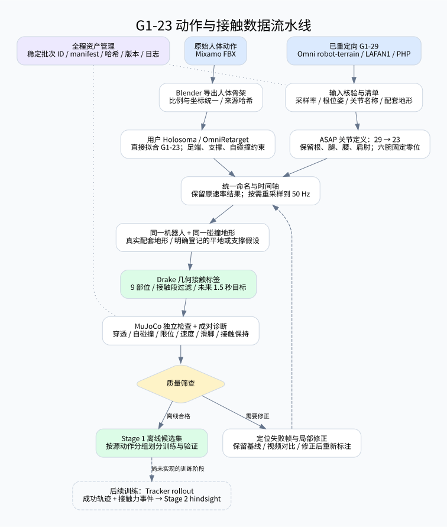

# G1 数据流水线知识库

本项目把不同来源动作处理为统一 G1-23 球手模型上的轨迹、静态地形与九部位几何接触标签。数据准备与 M2 已完成验收；M3 / Stage 1 的 walk＋爬箱共享 Tracker 训练已接入，PHP 暂时排除。

第一次使用从 [快速开始](01_使用指南/快速开始.md) 阅读，再查 [完整流水线手册](01_使用指南/数据流水线手册.md)。

## 01 使用指南：日常入口

- [SuperMimic 迁移与 4090 部署](01_使用指南/SuperMimic迁移与4090部署.md)：独立分支、便携训练包、世界模型／BPTT、验证边界与运行命令。
- [远程 M2 准备](01_使用指南/远程M2准备.md)：GitHub、SSH、数据传输和模型路径副本。

- [快速开始](01_使用指南/快速开始.md)：环境检查、四类数据运行、进度与回放命令。
- [数据流水线手册](01_使用指南/数据流水线手册.md)：算法、文件格式、接触标签、质量检查、修复与复用。
- [可视化与排错](01_使用指南/可视化与排错.md)：回放控件、源轨迹叠加、最差帧定位。

## 02 数据集：输入适配和当前结果

- [G1 29DoF 独立版本](02_数据集/G1_29DoF版本.md)：InstinctMJ 模型、基座转换、四类数据的生成／续跑、坐标约定与回放。

| 数据源 | 输入 | 入口说明 |
| --- | --- | --- |
| OmniRetarget | 已有 G1-29 + robot-terrain | [关节子集基线](02_数据集/OmniRetarget关节子集基线.md) |
| LAFAN1 | 已有 G1-29 CSV | [使用说明](02_数据集/LAFAN1使用说明.md) |
| Mixamo | 原始人体 FBX | [使用说明](02_数据集/Mixamo使用说明.md) |
| PHP | 已有 G1-29 训练包 + 箱体变体 | [使用说明](02_数据集/PHP使用说明.md) |

## 03 方法与规范：实验室共用约定

- [仓库文件与架构查询](03_方法与规范/仓库文件与架构查询.md)：按功能查询命令、模块与维护规则。

- [资产与版本管理规范](03_方法与规范/资产与版本管理规范.md)：目录职责、批次、缓存、来源追溯、迁移、数据划分。
- [接口与数据约定](03_方法与规范/接口与数据约定.md)：论文参数和后续训练模块接口设计。
- [肩肘接触局部修正](03_方法与规范/肩肘接触局部修正.md)：保留根、腰、腿的局部优化。

## 04 论文与复现：方法依据

- [复现路线](04_论文与复现/复现路线.md)。
- [论文原始资料与抽取记录](04_论文与复现/论文资料/)；原文件保留，不改写其内容与来源。

## 05 实验记录：历史证据

- [5080上23DoF四场景Stage1训练](05_实验记录/5080_23DoF四场景Stage1训练_20261104.md)：LAFAN行走＋Omni00／12／15、1024环境／24000轮、TensorBoard与实际部署修复。

- [29DoF质量与全身接触审计](05_实验记录/29DoF质量与全身接触审计_20261103.md)：四类数据实际准入状态、全身几何修复、滑动统计修正及 `fullbody-climb` 借鉴边界。

- [M3 RL 配置逐项审计](05_实验记录/M3_RL配置审计_20261103.md)：观测、网络、14项奖励、PPO、随机化、终止与评估协议的论文对照。
- [M3 控制与动力学诊断](05_实验记录/M3控制与动力学诊断_20261103.md)：已有回放失稳时序、冻结策略物理／延迟对照与200Hz力矩采集。
- [M3 接触接口审计](05_实验记录/M3接触接口审计_20261103.md)：失稳撞箱复核、法向接触力、几何标签与oracle点源对照。
- [M3 最终结果与演示报告](05_实验记录/M3两片段训练评估_20261103.md)：walk 99.90%、box 0%，中文HTML与成功／失败视频。
- [M3 两片段训练](05_实验记录/M3两片段训练.md)：共享 Tracker、参考信息隔离、训练／续训、指标及工程差异。
- [M2 仿真与机器人校准](05_实验记录/M2仿真与机器人校准.md)：运行方法、接口、工程参数、真实 PhysX 验收及 Stage 1 交接。
- [2026-10-30 资产整理与 PHP 接入](05_实验记录/20261030资产整理与PHP接入.md)。
- [Mixamo 坐下与爬梯修复](05_实验记录/Mixamo坐下与爬梯修复.md)。
- [早期方案](05_实验记录/早期方案/)：全身重拟合、旧批次抽查、单片段试验，作为历史记录。
- [数据快照](05_实验记录/数据快照/)：生成时刻的报告，最新状态以运行目录和统一 CLI 为准。

## 查资产

运行 `.venv/bin/python scripts/acp_pipeline.py list` 获取稳定 ID，运行 `catalog` 更新 [资产目录](../outputs/管理/资产目录.md)。[输出目录说明](../outputs/README.md) 定义数据、缓存与归档的位置。历史记录中的旧路径由 [迁移映射](../configs/assets_registry.json) 在读取时解析。
